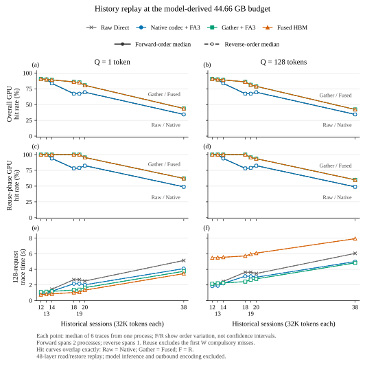

# 真实模型预算下的历史工作集回放（2026-11-01）

状态：全部完成。主矩阵 **112 个路径／配置／方向组合、672 条计时 trace、86,016 次请求**
通过独立审计；额外容量敏感性探针完成。GPU4 已释放。

- **独立 codec 减少传输与读取总耗时，但不增加 GPU 驻留容量。** 相对 Raw，
  Q=1 的完整 trace wall 降低 15.49–20.38%，Q=128 降低 7.41–17.42%；
  两者都只能容纳 13 个完整 32K 会话，命中率完全相同。
- **压缩 HBM 的容量收益在工作集越过原生容量后体现。** 可用 blocks 增加约 37%；
  Q=1 可容纳 19 个完整会话，Q=128 主矩阵为 18 个。
  W=18 时总体命中率由 67.19% 提高到 85.94%。
- **容量收益不能保证更快。** Q=128 时 Fused 全部比 Raw 慢 31.15–174.24%；
  Gather 在 W=12/13 时也比 Raw 慢 6.98–15.67%（合并两种 Q）。
  这些负结果保留在完整曲线与表格中。

以上范围涵盖所测点的正反序观测，不是置信区间或完整模型服务加速比。

本轮在独占 GPU4（NVIDIA H800）上实际加载
Qwen3-30B-A3B-Instruct-2507-FP8，保留 FP8 模型权重、BF16 KV，使用原生
vLLM 0.30.0 / FA3，TP=1、eager、APC、async scheduling，最大长度 65,536、
最多 4 sequences、每批 2,048 tokens、128-token blocks，
`gpu_memory_utilization=0.9`。启动 profiling 后完成 2,048 输入＋4 输出 token
生成，并关闭模型进程。后续按测得的预算运行独立的 48 层历史读取回放。

核心与读取 benchmark 使用 `feat/native-attention-external-codec` 的
`a5ddb75084c93bc1425d65f83f9fb5ca2352585f`，本轮未修改。本轮新增
[模型预算采集器](../benchmarks/native_codec_model_budget.py)。运行环境为
Python 3.10.20、Torch 2.13.0+cu129、vLLM 0.30.0+cu129、Triton 3.7.1。

## 实测预算

| 项目 | GB |
|---|---:|
| CUDA 可见总显存 | 85.017887 |
| vLLM requested memory | 76.516098 |
| 模型加载阶段消耗 | 31.242875 |
| profiling 其他净增消耗 | 0.520589 |
| profiling 瞬态峰值预留 | 0.090442 |
| **自动 KV 预算** | **44.662192** |
| 原生 vLLM 实际 KV 分配 | 44.656755 |
| 生成后 CUDA 口径占用／剩余 | 77.073285 / 7.944602 |

预算精确为 **44,662,192,128 B**，等于 requested memory 减去 profiling 的
持久净增消耗及瞬态预留。原生 vLLM 分配 3,549 blocks，即 454,272 tokens。
初始化快照已包含 0.550306 GB 非 Torch 占用，它不在 profiling 净增内；因此
0.9 utilization 不是整卡总占用严格不超过 90% 的承诺。warmup 日志另建议
减去固定 150 MiB 冗余，但未自动应用。这里使用引擎实际采用的自动预算。
[模型预算采集结果](data/model-kv-budget-20261101.json)。

## 容量探测与协议

每个历史会话含 32,768 tokens、256 blocks；每层 4 个 KV heads、32 个 query heads，
head dimension 为 128。Q 是单次 attention 读取的 query token 数。下表包括实际分配、Graph、恢复缓冲、
codec、48 层回放 Q/output 等张量，以 Torch allocated peak 计量，包含实际分配粒度
影响；不包含 CUDA context 与 allocator reserved。通过增加一个 block 检查预算边界。

Raw 和独立 codec 都在 GPU 保留原生 BF16 pages；后者压缩主机归档与 H2D 载荷，
恢复到原生 pages 后调用 FA3。Gather／Fused 则在 GPU 保留压缩块：前者先解码到
共享 workspace 再调用 FA3，后者使用自己的解码与 attention 融合内核。

| 路径 | Q=1 blocks／完整会话 | Q=128 blocks／完整会话 |
|---|---:|---:|
| Raw Direct＋FA3 | 3,547 / 13 | 3,539 / 13 |
| 独立 codec＋FA3 | 3,545 / 13 | 3,536 / 13 |
| 压缩 HBM Gather＋FA3 | 4,868 / 19 | 4,856 / 18 |
| 压缩 HBM Fused | 4,872 / 19 | 4,861 / 18 |

Q=128 的压缩路径距离第 19 个完整会话门槛（4,864 blocks）仅差 3–8 blocks。
回放将 48 层 Q/output fixture 也计入同一上限；这一离散边界是本回放的实测结果，
不是实际模型服务只能容纳 18 个会话的部署结论。
只按驻留 KV 字节计算的上界为 raw 3,549、压缩 arena 4,885 blocks；它们没有扣除
读取与恢复所需的其他张量，不能替代上表的实际峰值探测。原生 vLLM 的 3,549 blocks
与独立回放的分配边界也不能直接解释成优化前后的容量变化。

正式扫描 W=12、13、14、18、19、20、38 个会话，两种 Q 共用相同预算和请求序列。
每条 trace 从空 LRU 开始执行 128 个串行请求，先逐一访问全部会话，再按 seed=314 进行
80% 热半区／20% 冷半区访问；同时报告整体和排除首次触达后的复用命中率。
这里的命中率是 **GPU 驻留会话命中率**；全部外部历史始终可从未限容量的主机归档
取回，因此没有测量有限 DRAM 下的外部命中率。四条路径由回放器中相同的整会话 LRU 管理，
原生 vLLM 的块级复用与调度留待服务验证。
压缩路径每个恢复 chunk 处理 4 个 blocks，使用单接收缓冲与 Graph restore；
各路径都执行每请求完成检查，
Raw 使用原生布局直接 H2D，各路径均使用 attention read graphs。每配置一个校验 trace、一个 warmup，
随后六条计时 trace；正反序反转配置及路径顺序，共 672 条计时 trace、
86,016 次请求。执行修订提前固定：正序在 Q=128/W=18 完整配置之后分成两个进程，
剩余正序保持原顺序；反序由一个新进程完整执行。每个配置仍只有一次正序和一次反序
进程观测。仅接收通过全部检查的完整配置前缀，尾部未完成配置整组重跑。
分段用于避免准备、完整校验及 JSON 写盘超过最初的技术超时，并不改请求或计时窗口。
重启会改变 allocator、温度状态及轮间写盘间隔，因此按实际容量核验，F/R 中位数分别
保留；不把六条进程内 trace 当作独立服务重复，也不据此给置信区间。

历史数据沿用 OpenHands/Qwen3 的 BF16 KV 捕获：前 8 页校准，8:32 页评估，
通过重复和旋转构造独立会话身份。没有采集新的真实 32K 内容分布，也不按内容去重。
FP8 权重预算探针与旧捕获的 BF16/dequantized 来源分别记录。
query 矩阵由固定 seed=314 的标准正态数转为 BF16，未捕获真实模型的 query。
本捕获未触发 raw fallback 或 live overflow records，HBM overflow 分配仅 32,768 B；
容量收益尚不能外推到大量 fallback／overflow 的 KV 分布。

计时包括实际 pinned H2D、恢复与状态处理、LRU、48 层 attention 及完成等待；
归档编码、参考计算、位校验和 warmup 不计时，也不含新 KV 生成与写回。
模型权重不在回放进程中；
结果是模型预算约束下的缓存读取总耗时，不是完整模型 TTFT/TPOT。
校验要求所有恢复块逐位一致；三个 FA3 路径的 attention 输出也要求逐位一致，
Fused attention 输出使用 `atol=rtol=0.02`，不把该数值容差称为位级等价。

每个 32K 历史的 raw 载荷为 3,221,225,472 B；旋转后 compressed 载荷为
2,270,371,840–2,270,400,512 B，减少 29.51749–29.51838%。
W=38 的主机归档 raw／compressed 分别为 122.406568／86.274654 GB，
同时保留两种格式时合计 208.681222 GB。
默认 pinned 分配器逐份取整会膨胀到约 326.4 GB；全部正式回放进程统一设置
`PYTORCH_ALLOC_CONF=pinned_max_round_threshold_mb:1024,pinned_max_cached_size_mb:1024`，
同时禁止大块取整与缓存复用。实测三轮不同次序的分配、释放及 18 次 nonblocking H2D
视图传输均通过；每轮两份归档合计 5,491,617,792 B，释放后仅残留 1 B 小缓存。
数据布局及 GPU 路径保持不变。
运行前检查 248 GB 全机／cgroup 可用余量，并记录 NUMA1 与进程 RSS/HWM。
正式进程最大采样 RSS 为 216.009 GB，观测到的 kernel HWM 为 217.572 GB；
这是两种归档同时存在的实验进程内存，不是单一路径的部署开销。启动、切换、退出阶段
的 20 条无进程采样没有补成 0，失败批次的采样也未混入。
[载荷与主机内存核验数据](data/native-codec-model-budget-history-20261101-payload-host-review.json)。

## 结果

[矢量 PDF](figures/native-codec-model-budget-history-20261101.pdf) ·
[所有配置的耗时、命中、miss 与 H2D 表格](benchmark-model-budget-history-20261101-tables.md) ·
[逐 trace 数据](data/native-codec-model-budget-history-20261101-traces.csv) ·
[汇总 JSON](data/native-codec-model-budget-history-20261101-summary.json) ·
[来源与接纳记录](data/native-codec-model-budget-history-20261101-provenance.json)

下表为每条 **128 请求 trace 的总耗时，单位秒，正序 / 反序**；每个方向各取六轮中位数。

| Q | W | Raw Direct | 独立 codec | Gather＋FA3 | Fused |
|---:|---:|---:|---:|---:|---:|
| 1 | 18 | 2.678 / 2.675 | 2.159 / 2.154 | 1.351 / 1.353 | 1.029 / 1.026 |
| 1 | 38 | 5.141 / 5.137 | 4.095 / 4.091 | 3.751 / 3.752 | 3.450 / 3.446 |
| 128 | 18 | 3.627 / 3.631 | 3.120 / 3.119 | 2.429 / 2.430 | 5.720 / 5.724 |
| 128 | 38 | 6.050 / 6.048 | 4.996 / 4.997 | 4.831 / 4.831 | 7.935 / 7.947 |

W=18 时，Raw 和独立 codec 每条 trace 都有 42 次 miss；压缩 HBM 两路径只有 18 次。
含元数据的 H2D 总量分别为 **135.292、95.356、40.867 GB**。
独立 codec 在相同 miss 数下降低传输量；压缩 HBM 进一步减少 miss。
当 W=38 时，Raw／Native 总体命中率降至 34.38%，压缩 HBM 为 43.75%（Q=1）
或 42.19%（Q=128），因此扩大工作集后仍有容量收益，但不能避免全部容量 miss。

Q=128 的所测配置中，W=12–14 时独立 codec 最快；W=18、19、20、38 时 Gather 最快。
Q=1 则全部由 Fused 最快。它们说明原生 pages 避免命中后解码的成本，与压缩 HBM
减少未命中的收益之间存在取舍；没有据离散测点推算精确交叉点。
W=20 的 Raw 命中率高于 W=19，是固定有限 trace 下不同工作集的访问序列效应，
不是容量突然增加。

所有恢复 KV 均逐位通过。三个 FA3 路径的 attention 输出逐位一致；Fused 仅通过预定
数值容差，Q=1／128 的最大绝对误差分别为 0.015625／0.03125。
主矩阵所有实际容量与初始容量探针一致，正反序的命中与迁移字节完全一致。
56 个 F/R 配对的完整 trace wall 最大相对差异为 0.54213%（以 F 为分母）；这只是两次观测的差异，
不作为统计显著性或长期稳定性的证明。

## Q/output 记账的容量敏感性

Q=128 的 48 层 Q/output 各占 50,331,648 B，合计 **100,663,296 B**。
单独把探针的实际分配上限设为 **44,762,855,424 B**，等价于检查
`实际峰值 − Q/output ≤ 原 44,662,192,128 B`。这些张量仍实际存在；这不是删除分配，
也不是消除模型 profiling 中 90,441,728 B activation 预留的重复记账。

| 路径 | blocks | 完整 32K 会话 | 实际峰值 GB | 减去 Q/output 后 GB |
|---|---:|---:|---:|---:|
| Raw Direct | 3,547 | 13 | 44.740730 | 44.640067 |
| 独立 codec | 3,544 | 13 | 44.753353 | 44.652689 |
| Gather＋FA3 | 4,867 | 19 | 44.760257 | 44.659593 |
| Fused | 4,872 | 19 | 44.734665 | 44.634001 |

四路径均实际验证了下一 block 超过新上限，释放后 Torch allocated 为 0。
这说明主矩阵的 Q=128 压缩路径 18／19 会话边界对 fixture 记账敏感。
该探针不替换主矩阵容量，不重算任何命中率或耗时，也不作为真实服务容量。
[独立容量证据](data/native-codec-model-budget-history-20261101-capacity-sensitivity.json)。

## 后续验证

先保留独立 codec 的原生 attention 接口，把它接到真实服务的历史恢复路径，测包括模型
计算、排队、新 KV 写回及编码在内的完整请求耗时。再限制外部 DRAM 预算，并使用新的
长上下文捕获及更多 fallback／overflow 分布，判断外部压缩的容量收益。
当前的整体时延不能单独区分减少 H2D 字节、Graph 提交和 codec 计算各贡献多少；
下一轮应在同一服务负载上拆分这些开销。

## 已保留的运行记录

- 默认 pinned 分配器的首次主试验在 W=12/Q=1 完成后主动中断，防止更大工作集
  的主机分配浪费干扰实验；部分结果不与新的匹配对照混合。
- 首次主机分配探针未显式初始化 CUDA，统计接口返回空字典而失败；加入初始化后
  重新运行，pinned 属性与分配字节检查通过。

- 只关闭大块取整的第二次主试验在 W=12/Q=1 完成后、下一组准备阶段发生
  SIGSEGV。独立探针确认当前 Torch pinned allocator 将已释放的 2,270,392,320 B
  块返回给 3,221,225,472 B 请求，指针相同且未发生新分配；探针未写入疑似越界区域。
  该行为与缓存桶查找未核对实际块大小一致。正式扫描增加大块不缓存配置，
  不修改第三方源码；失败运行单独保存，不计入性能汇总。

- 正序分段接收规则、固定切分点和原协议哈希在切分点运行之前保存；原始部分结果
  不改写为成功结果，只有逐配置核验通过的连续完整前缀允许纳入最终审计。

- 第一次续跑的看护进程在子进程清理阶段等待超时，完整的初始异常未保留，原因未定。
  该批次全部排除，包括已经完成的配置；原始 manifest 的 `running` 状态也保留。
  修复异常落盘和有界清理后，按事先保存的重试声明重跑整段，核心源码与计时参数不变。

- 再次续跑的 benchmark 完整通过并正常退出，但看护程序随后报告 NVIDIA 查询超过
  10 秒，缺少正常关闭的监督记录。该批次也全部排除，没有把 `supervisor_error`
  改成成功；查询上限调整为 30 秒并记录慢查询后，再次原样重跑。

最终仅接纳预声明允许的 `history-main-r3` 完整前缀及正常退出的 `history-main-r6`；
`r1/r2/r4/r5` 均不计入性能汇总。r6 的两个命令均退出 0，源码前后哈希一致，
GPU 看护查询异常为 0，并记录到一次耗时 12.571 秒但成功返回的查询。
独立容量探针另用 `capacity-fixture-sensitivity-r2`，在启动前将相同监督查询上限
设为 30 秒，未改科学配置；也正常退出并释放全部 GPU 张量。
