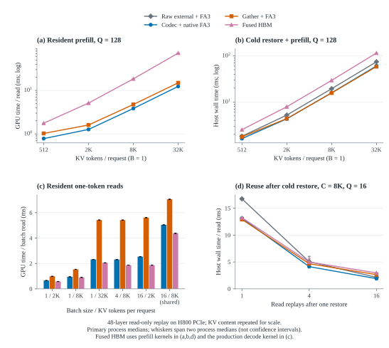
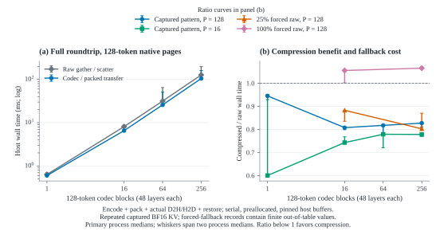

# 独立 codec 与 HBM 压缩路径：扩大规模对照

2026-10-31，`feat/native-attention-external-codec`，基础提交 `9edec04`。
本轮增加 benchmark 和证据，没有修改生产实现、vLLM 或 LMCache 源码。

**独立 codec 将解压成本放到恢复时；本轮可压缩输入的 HBM 压缩表示占用更少，但每次读取仍需解码。**
这次用 28 组 attention 配置、12 组 codec 往返配置扩大比较，每组完成主测与逆序复测。
主测22组 prefill 中，Native 相对 Gather 的 Graph 驻留读取耗时变化为 +6.96%～+53.44%，冷恢复后读取为
-3.50%～+28.29%；单 token 的 production fused decode 在 6/6 组驻留配置中快于 Native。
正百分比表示耗时降低，负数表示回退；下表保留全部结果。
大批量传输存在明显运行间波动：相同 P128/N256 的 raw 往返为 126.930／198.555 ms；
跨配置绝对耗时不能直接解释为页大小或 fallback 的影响。

## 路径与实验边界

| 路径 | 外部数据与恢复 | GPU 读取 |
| --- | --- | --- |
| Raw＋FA3 | raw pinned-host payload → H2D → 原生页 scatter | 原生 FA3 |
| Codec＋Native FA3 | FPKB → H2D → 校验、解码至原生 BF16 页 | 原生 FA3 |
| Gather＋FA3 | FPKB → H2D → 导入压缩 arena | 唯一物理页 gather 至临时 BF16，再 FA3 |
| Fused HBM | FPKB → H2D → 导入压缩 arena | 全 Q=1 使用当前 `decode_attention`；其余使用自动 split prefill |

Q=1 时的 Gather＋FA3 是用于分离读取路径成本的对照臂；实际 FragPack backend 在 decode 时调用 fused decode，
并不在每个 decode step 走 Gather＋FA3。以下将22组 prefill 与6组单 token 读取分别解释。

固定 **48 层、BF16 KV、32 Q heads／4 KV heads、head_dim=128**；attention 对照原生页大小为128。
物理卡2：H800 PCIe、114 SM，UUID `GPU-fb9880e5-6155-b080-837a-948d5fd08b4c`；
Python 3.10.20、PyTorch 2.13.0+cu129、vLLM 0.30.0+cu129、CUDA 12.9，NUMA 0。
FA3 显式 `fa_version=3`、`num_splits=0`、causal、scale=128⁻½。

KV 来自历史 CPU Transformers capture：Qwen3-30B-A3B-Instruct-2507-FP8 的权重先反量化为 BF16，
输入为 OpenHands 轨迹前4096 tokens。**KV 本身是 BF16，不是 FP8 KV，也不是 AgentX/GPU serving capture。**
原 dump 为 `[32,48,2,128,4,128] uint16`，SHA256：
`1302f31ac929ea3f623db0edcae7fa5869e50449c4b572dcff4ac17e7ae39322`。
校准页为 `0:8`；attention 的评估池为 `8:32`，往返为 `8:24`。
长上下文和大批量通过重复评估池内容、分配独立物理页扩大规模，不代表真实长上下文分布或新增独立样本。
25%/100% fallback 使用有限 BF16、码表之外的高字节构造整条 raw record，单独作为压力测试。

每层 Q 独立随机生成；所有 KV 在计时前已完整。C 包含右对齐 causal 的 Q 后缀。
共享场景的四臂使用相同物理页表；Gather 每层只解码唯一物理页集合。
R 表示一次恢复后对同一 Q/KV 重读 R 次，不是上下文增长的生成过程。
**未测新 KV 写入、投影/MLP、层间模型依赖、完整 serving、驱逐策略、RPC、网络或 SSD。**

每臂预热3次、正式24次。attention 四臂遍历24种顺序；codec 往返两臂逐轮交替先后。
两类实验都由第二个独立进程逆序复测。
驻留 Graph 用 GPU event 测48层读取；冷组计实际 H2D、公共恢复接口、status 回传/等待/检查、读取和完成的 host wall。
codec 往返另计保存端编码/打包/长度观察、实际 D2H、H2D、恢复和状态检查。
分阶段诊断单独采3次；不以阶段中位数相加替代完整时间。

图中为主测中位数，范围线覆盖两个进程的中位数，不是置信区间。

## 全部 attention 结果

驻留48层 Graph，单位 **ms／次读取**；R>1 用实际 R 次重放的 GPU span 除以 R。
两条 Native 的驻留计算相同，独立重复计时可能产生波动。

| 场景 | Raw＋FA3 | Codec＋Native FA3 | Gather＋FA3 | Fused HBM |
| --- | ---: | ---: | ---: | ---: |
| B1 C512 Q16 R1 | 0.745 | 0.742 | 0.978 | 1.000 |
| B1 C512 Q128 R1 | 0.782 | 0.780 | 1.026 | 1.765 |
| B1 C2K Q16 R1 | 0.810 | 0.812 | 1.141 | 1.405 |
| B1 C2K Q128 R1 | 1.267 | 1.267 | 1.603 | 5.116 |
| B1 C8K Q16 R1 | 1.145 | 1.148 | 1.944 | 2.274 |
| B1 C8K Q128 R1 | 3.844 | 3.849 | 4.759 | 18.457 |
| B1 C32K Q16 R1 | 2.646 | 2.654 | 5.699 | 6.269 |
| B1 C32K Q128 R1 | 12.377 | 12.377 | 14.953 | 72.244 |
| B1 C2K Q512 R1 | 2.779 | 2.776 | 3.146 | 14.110 |
| B1 C8K Q512 R1 | 10.738 | 10.773 | 11.579 | 54.409 |
| B4 C2K Q16 R1 | 1.152 | 1.144 | 1.920 | 2.542 |
| B4 C2K Q128 R1 | 3.721 | 3.722 | 4.544 | 15.186 |
| B16 C2K Q16 R1 | 3.503 | 3.515 | 6.536 | 10.508 |
| B16 C2K Q128 R1 | 9.319 | 9.332 | 12.231 | 49.051 |
| B4 C8K Q16 R1 | 2.713 | 2.720 | 5.748 | 7.084 |
| B4 C8K Q128 R1 | 12.292 | 12.284 | 14.860 | 55.846 |
| B4 C8K Q128 R1，共享 6K | 12.192 | 12.198 | 13.527 | 55.200 |
| B8 C8K Q128 R1，共享 6K | 18.452 | 18.417 | 20.597 | 96.042 |
| B4 C512/2K/8K/16K Q16/128/16/128 R1 | 6.299 | 6.298 | 8.686 | 41.991 |
| B1 C8K Q16 R4 | 1.155 | 1.150 | 1.949 | 2.275 |
| B1 C8K Q16 R16 | 1.161 | 1.142 | 1.956 | 2.276 |
| B4 C2K Q128 R4 | 3.760 | 3.771 | 4.594 | 15.397 |
| B1 C2K Q1 R1 | 0.657 | 0.658 | 0.988 | 0.578 |
| B1 C8K Q1 R1 | 0.948 | 0.951 | 1.533 | 0.897 |
| B1 C32K Q1 R1 | 2.317 | 2.314 | 5.422 | 2.051 |
| B4 C8K Q1 R1 | 2.317 | 2.309 | 5.418 | 1.870 |
| B16 C2K Q1 R1 | 2.537 | 2.534 | 5.608 | 1.860 |
| B16 C8K Q1 R1，共享 7K | 5.056 | 5.045 | 7.063 | 4.383 |

冷恢复＋48层 Graph，单位 **ms／次读取**。R>1 为一次恢复＋R次读取的完整 wall 除以 R，
属于摊销成本；R=1 是单次完整冷恢复与读取延迟。

| 场景 | Raw＋FA3 | Codec＋Native FA3 | Gather＋FA3 | Fused HBM |
| --- | ---: | ---: | ---: | ---: |
| B1 C512 Q16 R1 | 1.756 | 1.554 | 1.696 | 1.736 |
| B1 C512 Q128 R1 | 1.815 | 1.613 | 1.769 | 2.519 |
| B1 C2K Q16 R1 | 4.760 | 3.885 | 3.932 | 4.193 |
| B1 C2K Q128 R1 | 5.208 | 4.325 | 4.380 | 7.895 |
| B1 C8K Q16 R1 | 16.742 | 13.139 | 12.902 | 13.230 |
| B1 C8K Q128 R1 | 19.447 | 15.846 | 15.732 | 29.462 |
| B1 C32K Q16 R1 | 64.936 | 50.916 | 49.363 | 49.861 |
| B1 C32K Q128 R1 | 74.473 | 60.614 | 58.565 | 115.340 |
| B1 C2K Q512 R1 | 6.724 | 5.841 | 5.944 | 16.893 |
| B1 C8K Q512 R1 | 26.248 | 22.658 | 22.453 | 64.212 |
| B4 C2K Q16 R1 | 16.750 | 13.133 | 12.878 | 13.510 |
| B4 C2K Q128 R1 | 19.315 | 15.725 | 15.514 | 26.163 |
| B16 C2K Q16 R1 | 65.747 | 51.774 | 50.195 | 54.064 |
| B16 C2K Q128 R1 | 71.363 | 57.465 | 55.711 | 88.979 |
| B4 C8K Q16 R1 | 64.982 | 50.983 | 49.413 | 50.681 |
| B4 C8K Q128 R1 | 74.396 | 60.495 | 58.479 | 98.744 |
| B4 C8K Q128 R1，共享 6K | 39.398 | 33.148 | 32.612 | 73.823 |
| B8 C8K Q128 R1，共享 6K | 60.947 | 51.257 | 50.061 | 120.580 |
| B4 C512/2K/8K/16K Q16/128/16/128 R1 | 57.886 | 46.252 | 44.907 | 77.860 |
| B1 C8K Q16 R4 | 5.038 | 4.129 | 4.667 | 4.980 |
| B1 C8K Q16 R16 | 2.139 | 1.894 | 2.641 | 2.962 |
| B4 C2K Q128 R4 | 7.631 | 6.746 | 7.313 | 18.013 |
| B1 C2K Q1 R1 | 4.603 | 3.717 | 3.759 | 3.370 |
| B1 C8K Q1 R1 | 16.580 | 12.975 | 12.524 | 11.893 |
| B1 C32K Q1 R1 | 64.664 | 50.663 | 49.175 | 45.804 |
| B4 C8K Q1 R1 | 64.656 | 50.652 | 49.158 | 45.646 |
| B16 C2K Q1 R1 | 64.865 | 50.884 | 49.363 | 45.643 |
| B16 C8K Q1 R1，共享 7K | 49.894 | 39.645 | 38.460 | 35.777 |

主测与复测范围：

| 比较；正数表示耗时降低 | 主测范围 | 复测范围 | 主测／复测更快的配置数 |
| --- | ---: | ---: | ---: |
| Prefill Graph 驻留 Native vs Gather | +6.96%～+53.44% | +7.34%～+53.53% | 22/22；22/22 |
| Prefill Graph 冷恢复 Native vs Gather | -3.50%～+28.29% | -3.45%～+27.65% | 8/22；7/22 |
| 全部 Graph 冷恢复 Native vs Raw | +11.14%～+21.75% | +1.89%～+27.08% | 28/28；28/28 |
| 单 token Graph 驻留 Fused vs Native | +5.69%～+26.60% | +5.27%～+25.85% | 6/6；6/6 |
| Prefill Eager 驻留 Native vs Gather | +7.70%～+52.12% | +7.68%～+52.15% | 22/22；22/22 |
| Prefill Eager 冷恢复 Native vs Gather | -3.38%～+24.70% | -3.81%～+25.72% | 8/22；8/22 |
| 单 token Eager 驻留 Fused vs Native | +9.98%～+55.43% | +9.13%～+55.95% | 6/6；6/6 |

22组 prefill 中有 1 组 Native/Gather 冷路径排序在两个进程中反转；小幅差距不能写成稳定加速。两次原始结果均保留，未用较快一轮替换。

| 场景 | 主测 Native/Gather，ms／读 | 复测 Native/Gather，ms／读 | Native 耗时降低变化 |
| --- | ---: | ---: | ---: |
| B1 C2K Q16 R1 | 3.885/3.932 | 6.541/6.323 | +1.18% → -3.45% |

### 冷路径 host wall 的附加观察

C2K/Q16 的一次复测出现明显 host wall 增长，因此另启一个独立进程重测 Q16、Q128。源码、输入、查询和配置保持一致；第三次只观察 `cold_graph`，不替换或合并前两次结果。

| 场景 | 主测 Native/Gather，ms | 复测 Native/Gather，ms | 第三次 Native/Gather，ms | 第三次 Native 降低 |
| --- | ---: | ---: | ---: | ---: |
| B1 C2K Q16 R1 | 3.885/3.932 | 6.541/6.323 | 3.902/3.959 | +1.45% |
| B1 C2K Q128 R1 | 4.325/4.380 | 4.401/4.448 | 4.595/4.388 | -4.72% |

Q16 的 Native 路径同时查看完整 host wall 与独立诊断 GPU spans；下列各阶段来自诊断样本，不相加生成完整中位数。

| 进程 | 完整 wall，ms | H2D，ms | 恢复，ms | 读取，ms | 完整 stream span，ms |
| --- | ---: | ---: | ---: | ---: | ---: |
| 主测 | 3.885 | 2.575 | 0.453 | 0.833 | 3.890 |
| 复测 | 6.541 | 2.597 | 0.452 | 0.835 | 6.391 |
| 第三次 | 3.902 | 2.596 | 0.452 | 0.826 | 3.905 |

Q16 的 Native 复测相对主测，完整 wall 变化 +68.3%；独立诊断的 H2D／恢复／读取分别变化 +0.8%／-0.3%／+0.2%。

完整 wall／stream span 的变化与 H2D、恢复、读取阶段的变化分别列出；stream span 也包含 host 提交和状态检查之间的间隙。没有 CPU profiler，不能将差额精确归因于某个 CPU 操作。
附加观察另有 192 个主计时样本、24 个诊断样本，保存于 `host-wall-control.json`，不计入主矩阵总数。

所有 eager、Graph、主测/复测的 p10/p90、原始逐样本和诊断均保存在 `all-results.csv`／原始 JSON；
eager 包含 Python/API 提交成本，不能与驻留 Graph GPU 时间混为同一指标。

## 成本来自哪里

以 B1/C32K/Q128 为例，Native 相对 Gather 的完整冷路径变化为主测 -3.50%、
复测 -3.45%。三条压缩路径传输同一份 2.270 GB FPKB；
raw 传输 3.221 GB。独立阶段诊断如下：

| 阶段，ms | Raw＋FA3 | Codec＋Native FA3 | Gather＋FA3 | Fused HBM |
| --- | ---: | ---: | ---: | ---: |
| H2D payload＋offsets | 58.108 | 41.000 | 40.994 | 40.991 |
| 恢复：scatter／decode／import | 4.076 | 7.280 | 2.684 | 2.690 |
| 48 层读取 | 12.302 | 12.272 | 14.887 | 71.550 |

Native 在恢复时完成解压，后续 FA3 直接读取；Gather 将这项工作放到每次每层读取。
当前 Native 还检查记录 payload 和目标映射，旧 import 主要检查 header/几何/码表/长度；
这里比较完整公共接口，不是纯解压算法消融。Native 目标页冲突检查包含全表扫描，
扩大批量时应进一步隔离它与解码的成本，不能将全部恢复耗时归因于编码格式。

| C8K、Q16，读取次数 R | Native 冷恢复后每次读取 ms | Gather 每次读取 ms | Native 降低 |
| --- | ---: | ---: | ---: |
| 1 | 13.139 | 12.902 | -1.84% |
| 4 | 4.129 | 4.667 | +11.53% |
| 16 | 1.894 | 2.641 | +28.29% |

B4/C8K/Q128 的75%共享前缀把唯一物理块从 256 减为 112，
压缩接收 payload 从 2.270 减为 0.993 GB。
四臂都享受这项物理共享；它与压缩比是两个因素。

## 完整保存与恢复往返

以下包含保存端与恢复端的完整 host wall；原生页 P=16/128 都使用同一128-token codec record。
实际传输字节含 FPKB header、padding 和 raw fallback。

| 输入 / 原生页大小 / blocks | Raw 往返 ms | 压缩往返 ms | 主测降低 | 复测降低 | 实际 payload 减少 | raw fallback |
| --- | ---: | ---: | ---: | ---: | ---: | ---: |
| Capture / P128 / 1 | 0.637 | 0.602 | +5.51% | +7.15% | +29.59% | 0% |
| Capture / P128 / 16 | 8.117 | 6.554 | +19.26% | +20.16% | +29.51% | 0% |
| Capture / P128 / 64 | 31.661 | 25.870 | +18.29% | +21.49% | +29.51% | 0% |
| Capture / P128 / 256 | 126.930 | 104.983 | +17.29% | +19.01% | +29.51% | 0% |
| Capture / P16 / 1 | 2.614 | 1.569 | +40.00% | +4.86% | +29.59% | 0% |
| Capture / P16 / 16 | 25.763 | 19.133 | +25.73% | +23.25% | +29.51% | 0% |
| Capture / P16 / 64 | 68.158 | 53.071 | +22.13% | +27.99% | +29.51% | 0% |
| Capture / P16 / 256 | 270.558 | 210.445 | +22.22% | +23.03% | +29.51% | 0% |
| 25% fallback / P128 / 16 | 8.551 | 7.545 | +11.76% | +16.50% | +22.13% | 25% |
| 25% fallback / P128 / 256 | 308.829 | 247.742 | +19.78% | +13.01% | +22.13% | 25% |
| 100% fallback / P128 / 16 | 11.936 | 12.592 | -5.50% | -0.21% | -0.03% | 100% |
| 100% fallback / P128 / 256 | 280.127 | 298.338 | -6.50% | -7.20% | -0.03% | 100% |

出现任一进程回退的配置：100% fallback / P128、N16：主测 -5.50%、复测 -0.21%；100% fallback / P128、N256：主测 -6.50%、复测 -7.20%

因此压缩收益取决于实际少传的字节能否覆盖编码、解码和控制成本；fallback 比例必须随性能一起报告。
本轮固定实现，未根据结果重新挑选参数、剔除离群样本或改生产 kernel。

### 大批量传输的运行间波动

N256 的同一配置在两个进程中的完整时间差异明显。以下完整 host wall 与后面的诊断 GPU spans 属于不同样本。

| 原生页／进程，N256 | Raw 完整往返 ms | 压缩完整往返 ms |
| --- | ---: | ---: |
| P128／主测 | 126.930 | 104.983 |
| P128／复测 | 198.555 | 160.805 |
| P16／主测 | 270.558 | 210.445 |
| P16／复测 | 352.595 | 271.397 |

独立诊断中位数，ms；仅列主要阶段，编码路径另有 plan、pack 和控制开销：

| 页／进程／路径 | D2H payload | H2D payload | Gather／encode | Scatter／decode＋validate |
| --- | ---: | ---: | ---: | ---: |
| P128／主测／Raw | 60.510 | 58.160 | 4.070 | 4.082 |
| P128／主测／压缩 | 43.180 | 41.012 | 10.487 | 7.524 |
| P128／复测／Raw | 199.457 | 66.793 | 4.061 | 4.085 |
| P128／复测／压缩 | 137.705 | 47.417 | 10.473 | 7.529 |
| P16／主测／Raw | 209.715 | 67.073 | 4.063 | 4.143 |
| P16／主测／压缩 | 148.594 | 47.455 | 10.547 | 7.697 |
| P16／复测／Raw | 159.609 | 65.019 | 4.067 | 4.142 |
| P16／复测／压缩 | 111.986 | 45.197 | 10.552 | 7.698 |

诊断样本显示传输阶段存在较大波动；这些阶段中位数不能相加或用来精确归因前表主计时中位数的变化。GPU 独占没有隔离主机内存与 PCIe 资源，本轮没有 profile 具体原因。
因此，P128、P16 与不同 fallback 输入之间的绝对总时间差异，不能单独归因于页大小或 fallback。保留各进程内交替执行的 raw／压缩配对结果及全部样本，不将一次观察到的带宽视为平台恒定吞吐。

## HBM 与辅助空间

B1/C32K/Q128 的有效 KV 为 raw **3.221 GB**，
固定压缩 arena 预算 **2.340 GB**。
arena 是驻留分配预算，外部实际 payload 为另一口径。

| C32K、B1、Q128；当前显式分配，GB | Raw＋FA3 | Codec＋Native FA3 | Gather＋FA3 | Fused HBM |
| --- | ---: | ---: | ---: | ---: |
| GPU KV 数组（含保护页／原生描述符） | 3.2464 | 3.2464 | 2.3587 | 2.3587 |
| 当前 codec 自有缓冲 | 6.4448 | 6.4448 | 0.0000 | 0.0000 |
| HBM store 其他缓冲 | 0.0000 | 0.0000 | 0.0151 | 0.0151 |
| GPU 接收 payload | 3.2212 | 2.2704 | 2.2704 | 2.2704 |
| Gather／Fused 单层复用 workspace | 0.0000 | 0.0000 | 0.0671 | 0.0000 |
| Q＋单臂输出 | 0.1007 | 0.1007 | 0.1007 | 0.1007 |
| 显式 GPU 组件和（另含小型元数据） | 13.0131 | 12.0622 | 4.8119 | 4.7448 |
| pinned-host payload，单列 | 3.2212 | 2.2704 | 2.2704 | 2.2704 |

当前 NativeCodec 自有缓冲共 6.445 GB，其中 record scratch
3.221 GB、最大 blob 输出 3.222 GB；
本次恢复实验仍保留这些编码缓冲。Raw 也借用同一 NativeCodec API，所以表中同样列出它们，
**这不是普通 raw 路径天然需要的空间**。编码/恢复工作区拆分与有界池化是明确的后续方向。
Gather/Fused workspace 跨层复用地址；持久 KV 保留所有48层内容。

表中为单臂显式张量组成推算，包含两个保护页，另列 host pinned payload；
不含源页/归档构造、校验参考、其他臂、CUDA context、allocator reservation 和 Graph 私有 FA3 中间量。
因此它不是独立部署峰值，也不能直接换算成可承载的模型或请求容量。
本轮证明的容量区别是原生 BF16 与压缩驻留表示；是否卸载冷 KV 仍取决于外部策略。

## 验证与留存

- CPU 检查159项通过，Ruff/格式和 `git diff --check` 通过；两组 smoke 覆盖批量 prefill、decode/fallback。
- 28组 attention 和12组往返配置均完成两个独立进程，共 22,656 个主计时样本、
  2,832 个独立诊断样本；warmup 与初始准备不计入。
- 所有选中 KV 逐位一致，保护页保持不变。attention 冷组在恢复校验前污染目标，再恢复核验，避免沿用已有正确内容。
  Raw／Native／Gather 的 FA3 输出逐位一致；Fused 使用 `atol=rtol=0.02`，本轮最大绝对误差
  0.03125。这不是模型精度评估，也不承诺不同 attention 归约逐位一致。
- 五组主测/复测的源码、输入哈希/范围、查询/配置、payload 和 GPU 身份均匹配。
  独占启动检查及 1,493 次运行中占用采样未发现其他 GPU2 进程。
- 初次大输入准备在 NUMA 绑定下出现 NumPy 长时间分配而中止，当时启用了大页建议，尚无 GPU 计时样本；
  仅对子进程设置 `NUMPY_MADVISE_HUGEPAGE=0` 后重试。原准备记录与中止原因保留，未并入性能表。

证据目录名：`20261031-expanded-codec-comparison`。保留 `comparison-{primary,repeat}.json`、
各 `scale-*-{primary,repeat}.json`、`summary.json`、`all-results.csv`、启动/占用日志与冻结源码。
主 benchmark SHA256：`37f58245832ad471bfbc64ac29da658e801c67155a53d9501e17ab945eb3126f`；
scale benchmark：`28bbab6180484dc8f0e6c662833cbe782e42507afbbe79ffebbbefd16ac2b45b`。

源码入口：[四臂对照](../benchmarks/native_codec_comparison_bench.py)、
[codec 规模与 fallback](../benchmarks/native_codec_scale_bench.py)。
前一轮小规模结果保留在[原报告](comparison-native-codec-prefill-20261031.md)。
