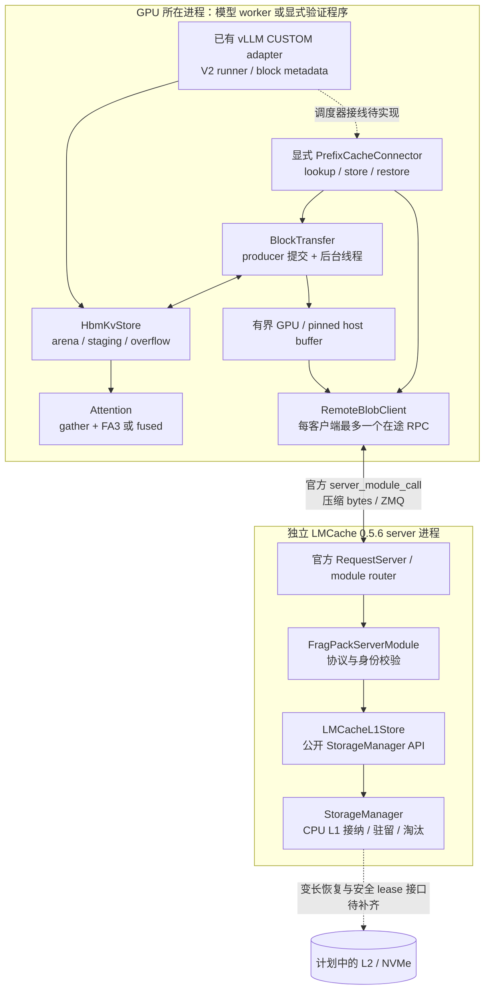
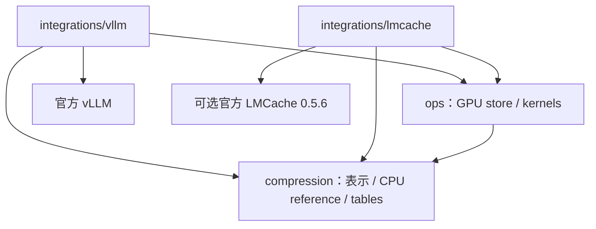

# 整体架构

FragPack 把 KV 表示、GPU 执行和系统适配分开。表示与 GPU core 只处理记录、
张量和 block 状态；vLLM adapter 提供模型执行所需的 block 所有权与 metadata；
LMCache integration 通过公开插件接口保存和恢复完整的压缩 block。

当前只讨论从请求起点连续匹配的前缀复用，不引入任意 chunk 拼接或位置重排。
LMCache 存取 API 已实现，但尚未接入 vLLM scheduler 的外部缓存生命周期。

---

## 进程与线程拓扑

实线表示当前实现的调用边界，虚线表示后续接线。GPU 测试程序已经显式调用
`PrefixCacheConnector` 所依赖的传输接口，将真实压缩记录经 RPC 存入原版
LMCache L1 后恢复到 GPU。图中的 vLLM scheduler 虚线尚未变成服务能力。

模型执行线程提交 export 和记录 CUDA event；后台线程等待事件、读取长度、
执行 D2H/H2D、RPC 和 import 状态检查。LMCache server 只接触 CPU 字节对象，
不打开 GPU IPC mapping，也不执行 FragPack 编解码。使用 GPU 的客户端与 CPU
server 可以独立配置可见设备；验证中的 server 隐藏所有 CUDA 设备。

独立 FragPack 不包含 DaseR 的 HTTP document API、`ServerCore`、
`TierIndex`、io_uring backend 或 SSD 文件格式。LMCache 的接纳与淘汰仍由
其自身管理；本插件使用公共 API，不替换该策略。

---

## 依赖与职责边界

| 边界 | 所有者 | 约束 |
|------|--------|------|
| KV 记录、码表与 raw fallback | `compression/`、`ops/` | 不导入 vLLM、LMCache 或外部层策略 |
| 物理 block 分配与请求进度 | 推理引擎及其 adapter | 传输期间保留源或目标 block；不能由裸地址猜测生命周期 |
| arena、record metadata、staging、overflow | `HbmKvStore` | 全层 KV 不因工作区复用而丢弃 |
| attention 的临时 BF16/FP32 工作区 | vLLM backend / 调用方 | 按 CUDA stream 顺序复用，不跨并发调用无保护共享 |
| 导出 blob、传输池和任务 future | `BlockTransfer` | 池满整批拒绝；不在 attention 热路径等待 I/O |
| 前缀身份和连续命中 | `CacheIdentity`、`PrefixCacheConnector` | 只能从请求起点连续复用；lookup 不等于 load 成功 |
| 外部对象的接纳、驻留与淘汰 | LMCache `StorageManager` | 当前只启用 CPU L1，按对象实际字节数申请 |
| 请求何时可以跳过计算 | 待接入的 scheduler adapter | 必须等待成功 import，不能只依据 RPC 接收或 lookup 命中 |

---

## 固定兼容目标

| 项目 | 当前目标与证据边界 |
|------|--------------------|
| Python / PyTorch | Python 3.10.20、PyTorch 2.13.0+cu129 |
| vLLM | 官方 0.30.0+cu129，V2 runner，`CUSTOM` backend |
| CUDA / GPU core | CUDA toolkit 12.9，SM90；BF16 KV，head dimension 128，block 128 tokens |
| Attention 几何 | GQA group 1、2、4、8；不支持 speculative decoding |
| LMCache | 官方 0.5.6，源码基线 `3e11e10812b448142c6cdb177a3058652bd826fa`；CUDA 12.9 wheel URL 与 SHA256 固定 |
| 模型服务 | 已有 TP=1 eager 验证；不能外推为 TP>1 或全模型 CUDA Graph 验证 |
| 外部缓存 | 当前 CPU L1 的显式存取已验证；没有 NVMe 恢复或 vLLM 外部缓存服务验证 |

依赖固定在 [vLLM requirements](../../requirements/vllm-cu129.txt) 与
[LMCache requirements](../../requirements/lmcache-cu129.txt)。GPU core 的原生
扩展在初始化/首次调用时编译，编译缓存位于仓库外。LMCache 可选依赖不进入
纯表示包的必要依赖。runtime 的版本检查不等同于验证用户自行修改过的源码。

---

## 启动与初始化

### 模型执行路径

1. 离线准备与模型和几何一致的码表；escape 与 raw fallback 保证码表未覆盖的
   BF16 位模式仍可表示，码表质量影响压缩率。
2. 以 `VLLM_PLUGINS=fragpack`、V2 runner、`CUSTOM` backend 加载 adapter。
   adapter 修改 KV page 规格，并在 runtime 包装 runner 的请求/block metadata
   获取边界；没有修改 vLLM 源码文件。
3. 创建 `HbmKvStore` 及明确计入预算的 arena、持久 staging、scratch、overflow、
   metadata、tables 和 attention workspace；初始化 native kernels。
4. 每个 step 按 scheduler 提供的实际存活 block 与输入 slot 准备状态，执行
   各层写入/attention/编码，最后 commit。详见 [HBM 设计](hbm-resident-kv.md)。

### 可选外部缓存路径

1. 从模型修订、执行配置、`store.table_digest`、层数、每 rank KV head 数和
   TP 身份生成 `CacheIdentity`。server 与 client 使用同一份身份配置。
2. 启动官方 LMCache 0.5.6 server，加载 FragPack `build_server_modules`，
   配置 CPU L1；没有 L2 adapter。插件在初始化和操作时检查这一约束。
3. 客户端创建官方 `RequestClient`、`RemoteBlobClient`、固定槽数的
   `BlockTransfer` 和显式 `PrefixCacheConnector`。
4. 调用方在全层编码完成后提交保存；恢复时先分配独占目标 block，并在
   import 成功前禁止 attention 读取。调用和回收规则见 [数据流程](flows.md)。
5. 退出时先停止提交并 drain 传输任务，再关闭 RPC；插件只清理自身状态，
   shared `StorageManager` 的关闭由 LMCache server 管理。

当前没有自动模型注册、scheduler 挂接或多 rank 命中协商。启动命令与可复现
显式调用示例见 [接入与验证](../lmcache-plugin-056.md)。

---

## 关键设计决策

| 决策 | 原因与影响 |
|------|------------|
| 完整 128-token block 是外部对象单位 | 保存同一 rank 的全层记录；未满尾块仍在本地追加，不能提前发布 |
| 外部直接搬运 FPKB 压缩记录 | export/import 不先还原 BF16、不重新执行编码；attn reader 仍可独立选择 |
| 主路径保留 `gather + FA3` | fused/split-KV 已有内核实现，但长 query 仍有性能限制；历史结果见专题引用 |
| direct 写入为独立 opt-in | 跳过完整新块的一次 scratch 搬运，不代表 scratch 容量已经删除 |
| 传输池按并发槽数设置 | 不按整个 KV cache 的最大容量预留；GPU 与 pinned host 占用独立计账 |
| 源复用、外部发布、目标可读分别报告 | 导出结束可复用源；只有实际发布后才能声称外部对象存在；恢复必须检查 import 状态 |
| 首先保持官方 LMCache 无源码修改 | 插件承载可外置的协议和传输；原生 L2 长度恢复与跨 lease 安全保证单独列为缺口 |
| 先验证数据正确性，再讨论收益 | bit-exact KV、attention 容差、模型输出和服务延迟是不同的证据层级 |

LMCache CPU L1 路径仍受原版预留 lease 约束：后台可以回收过期空间，manager
owner 不区分预约代次，插件无法单独提供跨任意暂停的强生命周期保证。
当前停止不确定操作后的继续接收，并保留必要清理责任；完整方案见
[后续接入与优化](lmcache-roadmap.md)。

---

## 状态与后续工作

目前的内核优化、KV 生命周期与显式 CPU L1 存取均已有实现及各自范围内的
功能证据。后续探索可以从这个状态继续，不需要把独立 LMCache migration
worktree 的修改当作运行前提。恢复外部前缀后的 reader 仍是可选的
gather/FA3 或 fused 路径；接入本身不提供端到端性能结论。

接下来需要完成的系统能力是 vLLM 调度接线、原生变长 L2 恢复和可靠的
reservation 生命周期。它们与未来性能优化候选及验收顺序集中记录在
[路线文档](lmcache-roadmap.md)，当前任务不启动这些后续开发或实验。
