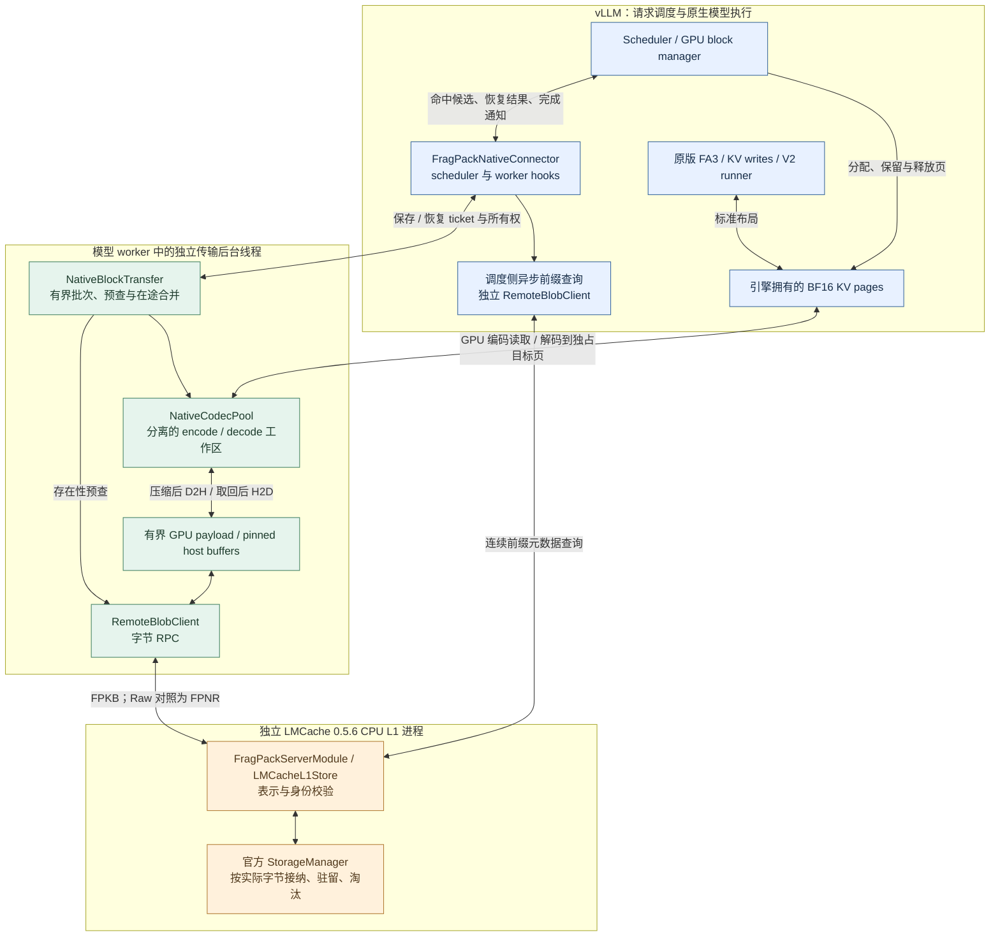
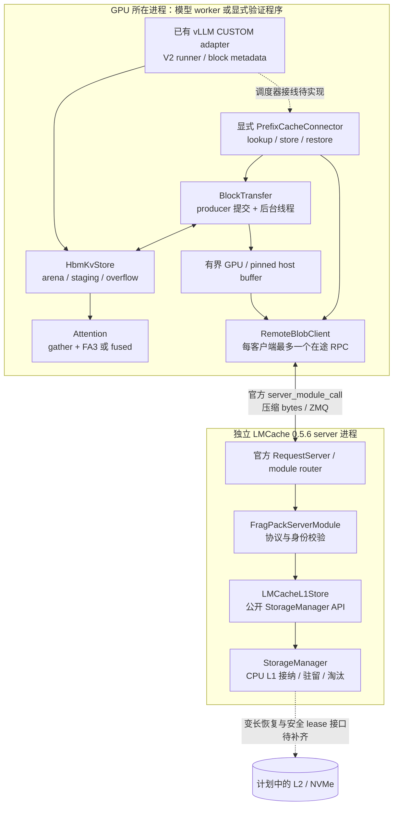
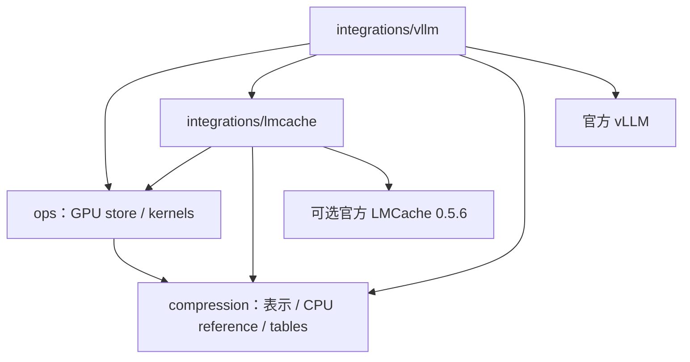

# 整体架构

FragPack 把 KV 表示、GPU 执行和系统适配分开。表示与 GPU core 只处理记录、
张量和 block 状态；vLLM adapter 提供模型执行所需的 block 所有权与 metadata；
LMCache integration 通过公开插件接口保存和恢复完整 block。

当前只讨论从请求起点连续匹配的前缀复用，不引入任意 chunk 拼接或位置重排。
两条 GPU 路径分别维护自己的生命周期：HBM 常驻压缩使用 `CUSTOM` attention 和
显式 `BlockTransfer`；原生 BF16 KV 路径已通过 `FragPackNativeConnector` 接入
vLLM scheduler，以 `NativeBlockTransfer` 在外部保存时编码、恢复时解码。后者不
修改 attention，也不增加活动 GPU KV 容量。

本分支当前的工作重点是原生 attention 的外部 codec。压缩表示与编解码由 FragPack
提供，请求调度、GPU 页分配由 vLLM 管理，外部对象驻留与淘汰由 LMCache 管理。
编码前预查和在途合并只减少重复工作，不引入新的缓存策略。

| 路线 | GPU 常驻 KV | Attention / runner | 外部缓存接线 |
| --- | --- | --- | --- |
| 原生 attention 外部 codec | 标准 BF16 pages；辅助工作区需另计 | 原版 FA3 和 V2 runner，通过公开 KV connector hooks 接入 | 已实现原生页与 CPU L1 之间的编解码、保存和恢复 |
| HBM 常驻压缩 | 完整块为压缩记录，未满块为 BF16 staging | `CUSTOM` attention、runtime runner wrapper；prefill 默认 gather + FA3 | 显式 `BlockTransfer` 已验证，scheduler connector 尚待实现 |

---

## 进程与线程拓扑

### 原生 attention 与外部 codec

保存先在 GPU 编码，再传较小的对象到 CPU L1；恢复按相反方向搬运，在 GPU
解码到原生页后才交给 attention。CPU L1 保存字节对象，不执行 codec，也不拥有 GPU 页。
Raw 对照走相同控制流程，以 gather/scatter 取代编解码，并使用隔离的 FPNR 表示。

三个完成点分别控制不同资源：各批次 `source_ready` 成功表示不再读取相应源页；
所有保存批次的源读取完成后，connector 才通知引擎释放请求的源页；发布
`completion` 确认外部对象已可见。恢复则须本请求所有计划批次都成功后通知
scheduler；任何批次 miss 或失败均交由 vLLM 重算，不能只根据 lookup 或部分成功跳过 prefill。

当前保存正常完成请求中已满的 prompt blocks，不新增保存生成 token 或不完整尾部。
源页在预查期间仍被保留。已有外部对象时跳过编码和上传；该对象被淘汰后可以重新保存。
没有接入冷块候选队列、lazy offload、预测预取或 NVMe。

### HBM 常驻压缩与显式传输

下图描述 HBM 常驻压缩与其显式外部传输；scheduler 虚线仅指这条路径。

实线表示当前实现的调用边界，虚线表示后续接线。GPU 测试程序已经显式调用
`PrefixCacheConnector` 所依赖的传输接口，将真实压缩记录经 RPC 存入原版
LMCache L1 后恢复到 GPU。

两条路线共用 CPU L1 字节服务，但模型接线不同。原生路线的详细契约见
[原生 connector](native-codec-vllm-connector.md)和[原生页传输](native-lmcache-transfer.md)。

HBM 路线的模型执行线程提交 export 和记录 CUDA event；后台线程等待事件、读取长度、
执行 D2H/H2D、RPC 和 import 状态检查。LMCache server 只接触 CPU 字节对象，
不打开 GPU IPC mapping，也不执行 FragPack 编解码。使用 GPU 的客户端与 CPU
server 可以独立配置可见设备；验证中的 server 隐藏所有 CUDA 设备。

独立 FragPack 不包含 DaseR 的 HTTP document API、`ServerCore`、
`TierIndex`、io_uring backend 或 SSD 文件格式。LMCache 的接纳与淘汰仍由
其自身管理；本插件使用公共 API，不替换该策略。

---

## 依赖与职责边界

| 边界 | 所有者 | 约束 |
|------|--------|------|
| KV 记录、码表与 raw fallback | `compression/`、`ops/` | 不导入 vLLM、LMCache 或外部层策略 |
| 物理 block 分配与请求进度 | 推理引擎及其 adapter | 传输期间保留源或目标 block；不能由裸地址猜测生命周期 |
| arena、record metadata、staging、overflow | `HbmKvStore` | 全层 KV 不因工作区复用而丢弃 |
| attention 的临时 BF16/FP32 工作区 | vLLM backend / 调用方 | 按 CUDA stream 顺序复用，不跨并发调用无保护共享 |
| 原生 BF16 pages 与 codec workspace | 引擎、`NativeCodecPool` | pages 仍由原生 attention 使用；编解码工作区按有限并发批次分配 |
| blob、传输池和任务 future | `BlockTransfer` / `NativeBlockTransfer` | 池满整批拒绝；不在 attention 热路径等待 I/O |
| 前缀身份和连续命中 | `CacheIdentity`、相应 connector | 本地 APC 与外部命中只能组成连续前缀；lookup 不等于 load 成功 |
| 外部对象的接纳、驻留与淘汰 | LMCache `StorageManager` | 当前只启用 CPU L1，按对象实际字节数申请 |
| 请求何时可以跳过计算 | 原生路线的 `FragPackNativeConnector`；HBM 路线接线待实现 | 必须等待恢复成功，不能只依据 RPC 接收或 lookup 命中 |

---

## 固定兼容目标

| 项目 | 当前目标与证据边界 |
|------|--------------------|
| Python / PyTorch | Python 3.10.20、PyTorch 2.13.0+cu129 |
| vLLM | 官方 0.30.0+cu129，V2 runner；HBM 路线使用 `CUSTOM`，原生路线保留标准 attention backend |
| CUDA / GPU core | CUDA toolkit 12.9，SM90；BF16 KV，head dimension 128，逻辑对象 128 tokens；native codec 支持 16/32/64/128-token 物理页，本轮模型验证使用 128-token 页 |
| Attention 几何 | HBM kernel 支持 GQA group 1、2、4、8；原生路线限定单 FullAttentionSpec group；均未支持 speculative decoding |
| LMCache | 官方 0.5.6，源码基线 `3e11e10812b448142c6cdb177a3058652bd826fa`；CUDA 12.9 wheel URL 与 SHA256 固定 |
| 模型服务 | 已有 TP=1 eager 验证；不能外推为 TP>1 或全模型 CUDA Graph 验证 |
| 外部缓存 | 显式 CPU L1 存取、原生 connector 小模型功能及有限协议主模型对照已验证：原生 FA3、TP=1、eager、离线串行；未验证 HTTP 服务、NVMe、TP>1 或 CUDA Graph |

依赖固定在 [vLLM requirements](../../requirements/vllm-cu129.txt) 与
[LMCache requirements](../../requirements/lmcache-cu129.txt)。GPU core 的原生
扩展在初始化/首次调用时编译，编译缓存位于仓库外。LMCache 可选依赖不进入
纯表示包的必要依赖。runtime 的版本检查不等同于验证用户自行修改过的源码。

---

## 启动与初始化

### HBM 常驻压缩模型执行路径

1. 离线准备与模型和几何一致的码表；escape 与 raw fallback 保证码表未覆盖的
   BF16 位模式仍可表示，码表质量影响压缩率。
2. 以 `VLLM_PLUGINS=fragpack`、V2 runner、`CUSTOM` backend 加载 adapter。
   adapter 修改 KV page 规格，并在 runtime 包装 runner 的请求/block metadata
   获取边界；没有修改 vLLM 源码文件。
3. 创建 `HbmKvStore` 及明确计入预算的 arena、持久 staging、scratch、overflow、
   metadata、tables 和 attention workspace；初始化 native kernels。
4. 每个 step 按 scheduler 提供的实际存活 block 与输入 slot 准备状态，执行
   各层写入/attention/编码，最后 commit。详见 [HBM 设计](hbm-resident-kv.md)。

### HBM 路线的显式外部缓存

1. 从模型修订、执行配置、`store.table_digest`、层数、每 rank KV head 数和
   TP 身份生成 `CacheIdentity`。server 与 client 使用同一份身份配置。
2. 启动官方 LMCache 0.5.6 server，加载 FragPack `build_server_modules`，
   配置 CPU L1；没有 L2 adapter。插件在初始化和操作时检查这一约束。
3. 客户端创建官方 `RequestClient`、`RemoteBlobClient`、固定槽数的
   `BlockTransfer` 和显式 `PrefixCacheConnector`。
4. 调用方在全层编码完成后提交保存；恢复时先分配独占目标 block，并在
   import 成功前禁止 attention 读取。调用和回收规则见 [数据流程](flows.md)。
5. 退出时先停止提交并 drain 传输任务，再关闭 RPC；插件只清理自身状态，
   shared `StorageManager` 的关闭由 LMCache server 管理。

这条 HBM 传输路线没有自动模型注册、scheduler 挂接或多 rank 命中协商。启动命令与可复现
显式调用示例见 [接入与验证](../lmcache-plugin-056.md)。

### 原生 attention 的外部 codec

配置 `FragPackNativeConnector`，由原生引擎分配 BF16 KV pages。connector 注册
pages 的零拷贝视图，创建有界 `NativeBlockTransfer`，在正常请求结束时保存完整
prompt blocks；外部恢复完成后才通知 scheduler 跳过相应 prefill。raw 与 compressed
采用相同策略，分别使用独立 namespace 的 FPNR 与 FPKB。配置和执行入口见
[开发说明](../development.md)，计时边界见[验证设计](native-codec-serving-validation.md)。

该路线通过 `kv_connector_module_path` 加载，不启用 `CUSTOM` plugin 或 HBM runner
wrapper。编码池、解码池、传输缓冲和 page maps 都计入辅助预算；相同总预算下，
这些开销会减少可分配的原生页数。压缩节省的是外部对象和传输 payload。

---

## 关键设计决策

| 决策 | 原因与影响 |
|------|------------|
| 完整 128-token block 是外部对象单位 | 保存同一 rank 的全层记录；未满尾块仍在本地追加，不能提前发布 |
| HBM 路线直接搬运 FPKB 记录 | export/import 不先还原 BF16、不重新执行编码；attn reader 仍可独立选择 |
| 原生路线只压缩外部对象 | GPU 活动 KV 保持 BF16；以有界 codec 工作区换取较小的外部对象和传输量，收益需实测 |
| HBM 主路径保留 `gather + FA3` | fused/split-KV 已有内核实现，但长 query 仍有性能限制；历史结果见专题引用 |
| HBM direct 写入为独立 opt-in | 跳过完整新块的一次 scratch 搬运，不代表 scratch 容量已经删除 |
| 传输池按并发槽数设置 | 不按整个 KV cache 的最大容量预留；GPU 与 pinned host 占用独立计账 |
| 源复用、外部发布、目标可读分别报告 | 源读取结束才可复用；只有实际发布后才能声称外部对象存在；恢复必须检查 import/decode 状态 |
| 首先保持官方 LMCache 无源码修改 | 插件承载可外置的协议和传输；原生 L2 长度恢复与跨 lease 安全保证单独列为缺口 |
| 先验证数据正确性，再讨论收益 | bit-exact KV、attention 容差、模型输出和服务延迟是不同的证据层级 |

LMCache CPU L1 路径仍受原版预留 lease 约束：后台可以回收过期空间，manager
owner 不区分预约代次，插件无法单独提供跨任意暂停的强生命周期保证。
当前停止不确定操作后的继续接收，并保留必要清理责任；完整方案见
[后续接入与优化](lmcache-roadmap.md)。

---

## 状态与后续工作

两条路线的组件均已有范围明确的功能证据；原生 connector 已完成小模型功能与
真实 CPU L1 的[固定预算主模型对照](../validation-native-codec-serving-20261101.md)。
本轮总请求及发布窗口改善不等于 TTFT 加速：W18 外部恢复 TTFT 高于重算。
编码前的存在性检查与在途保存合并只是减少重复工作的辅助措施，语义见
[逐键查询](lmcache-probe.md)。

当前优先优化压缩记录传输中的 CPU 封装与复制，再验证有界缓冲下的编解码、DMA
和发布重叠。报告分别保留真实 TTFT、生成加发布窗口、工作区占用和外部 payload，
不以单一窗口的改善替代请求延迟结论。

HBM 路线的 scheduler 接线、LMCache 变长 L2 恢复和更强的 reservation 生命周期
仍是后续工作，见[路线文档](lmcache-roadmap.md)。这些能力不属于当前原生路线的
性能结论，也不能从功能通过推导出来。
