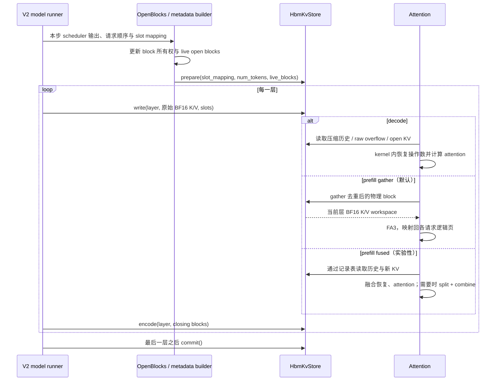
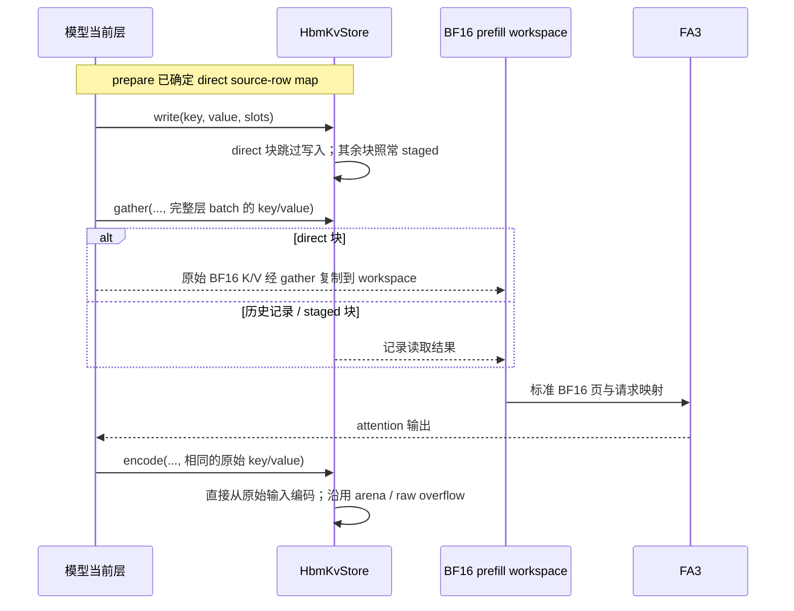
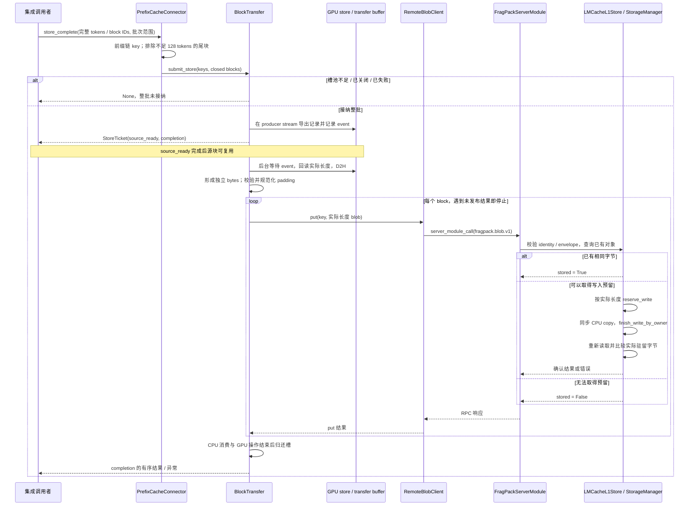
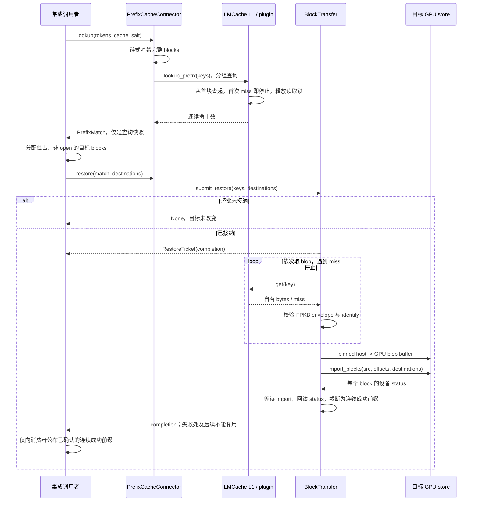

# 数据流程

本文档主要描述 HBM 常驻压缩 attention 和显式 LMCache 存取 API。
下列图中的“集成调用者”持有请求和物理 block 生命周期，这条 HBM 路线尚未
接入 vLLM scheduler 的外部缓存 hooks。已实现的原生 attention 路线另见末节。
L2/NVMe 只在
[后续设计](lmcache-roadmap.md)中描述，不属于下列已实现存取路径。

## 新 KV 与本地 attention

模型产生的 K/V 已经是 BF16。默认 `staged` 路径把新值整理到可写存储，attention
读取历史记录和当前新值；满块在其参与的本层 attention 之后编码。图中的 kernel
调用表示在模型当前 CUDA stream 上按序提交，不表示每一步都等待 GPU 同步完成。

一个 block 在多个轮次才填满时，它的所有层 KV 都需要保留。每轮都只保留精确的
未满块集合；请求完成、抢占或物理块重分配后，不能把旧 staging 继续当成活跃数据。
同一 prefill pass 中共享物理 block 的请求可以共享一次 gather 的结果，但不同层、
不同 pass 和不同 step 不共享其 KV 内容。

`fused` prefill 不再经过 FA3。它在自身 kernel 内读取压缩记录并完成 attention；
split-KV 的 FP32 partial workspace 存的是 attention 中间结果，不是解压后的全量
BF16 KV。具体状态和内存关系见[HBM 常驻 KV](hbm-resident-kv.md)。

---

## 完整新块的 direct 写入

`FRAGPACK_WRITE=direct` 只适用于 `FRAGPACK_PREFILL=gather`。prepare 在 GPU 上确认
某个新分配 block 的 128 个输入 slot 连续且完整覆盖后，记录其在完整层 batch 中的
source row。旧 open block、不完整尾块或未通过覆盖检查的块继续使用 staged 路径。

原始层 K/V 必须保持存活、不可变，直到本层编码完成。不能给 gather group 传入
局部切片替代完整层 batch，也不能用没有写过的 scratch 代替输入。最后一层 commit
清除 direct map，下一步 prepare 重新建立它。这个路径减少搬运，当前没有删除已预留
的 scratch 容量，也不改变 FPKB 格式。

---

## 闭合 block 保存到 LMCache L1

一个 FPKB blob 包含一个完整 128-token block 的所有层、当前 TP shard 的所有 KV
heads。调用者必须将 export 排在全部层编码及本步提交之后，并保留物理源块。
未满尾块不参与本路径。

`source_ready` 是源 block 的释放界限，不代表缓存已写入。`completion` 中的 True
表示服务端已观察到相同字节驻留，之后仍可能被正常淘汰。已有同 key 但不同字节是
冲突，不能无条件覆盖。异常可能出现在某些较早块已经成功发布之后，不能把异常当作
整个批次已经回滚。

GPU 导出和 pinned-host 槽由 FragPack 持有；LMCache 的预留只接收同步 CPU copy。
仍需遵守原版预留 TTL，不能把快速 CPU copy 视为跨任意暂停的强寿命保证。
具体限制见[LMCache 接入](lmcache-integration.md)。

---

## 前缀匹配、恢复与 attention 就绪

下面是 HBM 显式 API 已支持的顺序。将这条路径的“成功恢复后跳过相应 prefill”
接入 vLLM scheduler 仍属于后续工作；单独加载 HBM attention 插件不会自动
触发外部前缀恢复。

lookup 命中不会长期 pin L1 对象。若对象在 lookup 与 get 之间被淘汰，restore 仍可
miss。字节已读入也不代表 attention 就绪：H2D、GPU import 和 status 确认必须全部
完成。导入失败可能已安装某些层的记录，此时整个 block 仍应重算；后续即使成功
导入的 block 也不能跨过前缀缺口使用。异常时整个 ticket 的目标集合不报告可复用。

恢复成功后，压缩记录直接装回 arena，raw fallback 装回 overflow，不先重建完整
BF16 缓存。后续 attention 使用哪条路径由 backend 配置决定：默认 prefill 仍需
gather + FA3，decode 与实验性 fused prefill 则在各自 kernel 内读取这些记录。

---

## 背压、错误与关闭

| 场景 | 对外结果 | 所有权与后续动作 |
|------|------|------|
| 单批 block 数超过可用槽 | `None`，整批拒绝 | 不提交部分 GPU 工作；调用者保留原所有权，之后按容量重试或重算 |
| 查询命中但 get 时已淘汰 | restore 的成功前缀缩短 | 首次 miss 处开始重算；不继续跨缺口复用 |
| 写预留被拒绝 | 当前 store 及后续块为 False | 早先已发布对象可保留；不伪造新命中 |
| FPKB 非法 / namespace 不符 / 现有字节冲突 | 异常 | 不把请求标记为成功；能确认 DMA 已结束时可释放 transfer 槽 |
| import overflow 等非零 status | 失败块及后续为 False | 不能把部分成功层当作完整 KV；调用者按结果重算 |
| RPC 发送或等待超时 | Future 异常，remote client 进入 failed | 底层请求可能仍在途；禁止继续积累请求，先关闭旧 RequestClient 再重建连接 |
| L1 发布无法确认或预取 wait/query 出错 | store 停止接纳；未决句柄保留 | 不强制按 key 删除其他任务的数据；完成的读句柄可在 close 清理，永不完成的句柄依赖 manager 关闭 |
| CUDA 操作失败且不能确认完成 | transfer 进入 failed，Future 异常 | 隔离槽池、ID 张量和任务所有者，禁止复用不确定内存；需要进程恢复 |
| `close(timeout)` 超时 | `TimeoutError` | 不取消已接纳工作，不提前释放 tensor；后续仍可等待 close 完成 |

正常关闭先停止新的提交，调用 `BlockTransfer.close()` 排空已有任务，再关闭调用者
拥有的 RequestClient。插件的 `close()` 只清理自身状态，随后由 LMCache 关闭共享
StorageManager。不能在 transfer worker 自己执行的 Future callback 中调用 close，
以免 join 自己。已接纳的 Future 不支持通过取消跳过 buffer 寿命要求。

读写预留的过期代次、L2 对象长度发现与恢复、跨 TP rank 的共同命中，以及 HBM
路线的 vLLM load/save 接线仍需设计和验证，见[后续设计](lmcache-roadmap.md)。

## 原生 attention 的外部 codec 流程

`FragPackNativeConnector` 已连接 vLLM 的公开 scheduler/worker hooks。活动 KV
保持标准 BF16 pages，attention 不读取压缩记录，也不使用上述 gather/fused backend。

1. 正常请求完成后，connector 延迟释放完整 prompt blocks，并提交有界保存批次。
   `NativeBlockTransfer` 先做逐键存在性查询；仅对缺失对象编码、D2H 并发布到 CPU L1。
   源页在预查期间也保持受保护，全部源读取完成后才可释放，不必等远端发布结束。
2. 新请求先使用本地 APC；外部查询只提供连续前缀候选。worker 将外部 bytes 经
   H2D 和 decode/scatter 恢复到独占的原生页。成功完成后 scheduler 才跳过相应
   prefill，失败则重算；最终 prompt token 和不完整尾部仍由模型计算。
3. raw 对照沿用相同保存时机、批次和恢复协议，使用 FPNR raw gather/scatter；
   compressed 使用 FPKB 编解码。空 model steps 也驱动完成通知和发布排空。

所有权、取消和失败细节见[原生 connector](native-codec-vllm-connector.md)、
[传输设计](native-lmcache-transfer.md)。原生路线的
[有限协议主模型对照](../validation-native-codec-serving-20261101.md) 已完成，范围是
原生 FA3、TP=1、eager、真实 CPU L1 和离线串行回放。总请求及发布窗口改善不等于
TTFT 加速，W18 外部恢复 TTFT 高于重算。HTTP、NVMe、TP>1、CUDA Graph 及
HBM 路线的 scheduler 接线仍不属于本轮验证范围。
