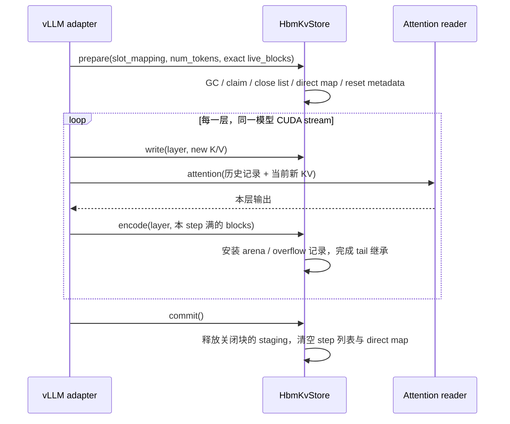

# HBM 常驻压缩 KV

FragPack 将已满 block 的 KV 以无损记录保留在 HBM 中，由 attention reader
按需还原。新 KV 来自模型的 BF16 输出；未满 block 保持可追加，填满后才编码。
本文描述当前独立 FragPack 实现的记录、GPU 状态机和 attention 路径，外部缓存
的发布与恢复见 [LMCache 接入设计](lmcache-integration.md)。

## 组件职责

| 组件 | 代码 | 职责 |
|------|------|------|
| 参考表示与码表 | `fragpack/compression/attn_page.py`、`attn_tables.py` | 逐位参考编解码、码表标定、FPKB 大小推导 |
| GPU store | `fragpack/ops/hbm_kv.py`、`hbm_kv.cu` | block 状态、staging、共享 page、overflow、导入导出 |
| Decode attention | `fragpack/ops/fused_attn_decode.py`、`.cu` | 直接读取记录，融合解压与 attention |
| Prefill attention | `fragpack/ops/fused_attn_prefill.py`、`.cu` | 实验性融合 prefill、split-KV 规划与合并 |
| vLLM backend | `fragpack/integrations/vllm/backend.py` | KV page spec、metadata、逐层调度与 workspace 所有权 |
| 请求与共享页规划 | `fragpack/integrations/vllm/lifecycle.py`、`prefill.py` | 镜像 scheduler block 列表、绑定实际 batch、规划一次 gather 的共享页 |
| 容量快照 | `fragpack/integrations/vllm/capacity.py` | 发布只含主机元数据的分项分配快照 |

表示与 GPU core 不导入 vLLM 或 LMCache。adapter 提供请求身份与 block
所有权，core 只接收张量、地址表和明确的生命周期操作。

---

## 记录格式与码表

一条记录对应一个 `(block, layer, K/V, KV head)` 的
`128 token × 128 dimension` BF16 切片，共 16,384 个标量。

| 部分 | 大小 | 内容 |
|------|-----:|------|
| 低字节 | 16,384 B | 每个 BF16 的低 8 位原样保存 |
| 高字节符号 | 6,144 B | 3-bit 主符号流 |
| Dense 合计 | 22,528 B | 按 GPU 内核线程读取顺序排布 |
| 可变部分 | 不超过 2,048 B | header、escape nibble、原始高字节，16 B 对齐 |
| Raw fallback | 32,768 B | 整条记录按 BF16 位模式保存 |

码表按 `(layer, K/V, head)` 离线标定，文件中的 `table` 是
`uint8[layers, 2, kv_heads, 22]`。`FRAGPACK_TABLES` 指向该 `.npz` 文件；
TP 分片按本 rank 的 KV head 范围选取。码表影响压缩率，不限制可表示的值：
不在码表内的值经过 escape/raw 路径保存。可变部分超过 `VAR_CAP=2048`，或
任一 warp 需要保存的 raw 标量超过 32 时，整条记录进入 raw fallback。

无损指恢复后的 BF16 **位模式完全一致**，包括特殊位模式；不等于换用另一种
attention reduction 顺序后，输出浮点数或生成 token 必然一致。

### 共享 arena page

vLLM 的每层 KV tensor 自身就是 arena，store 不另分配一套 arena。block `b`
在层 `l` 的 page 是该层 tensor 的第 `b` 行，按实际行 stride 定位。

```text
page_bytes(H) = 2 × H × (DENSE_BYTES + VAR_SHARE)
DENSE_BYTES = 22528
VAR_SHARE = 1280
```

同一 block-layer 的 `2H` 条记录共享这个 page。encode 用 CAS 在
`fill[layer, block]` 上申请实际 `DENSE_BYTES + var_len` 字节；申请失败不推进
`fill`，后续较小记录仍可利用剩余空间。记录自身无法编码称为 fallback；
记录可编码但 page 放不下称为 spill。两者最终都以 raw 形式保存在 overflow 池。

例如 `H=4` 时，page 为 190,464 B，对应 raw page 为 262,144 B，几何比例约
1.38。这个比例只描述 arena page 布局，不能直接换算成总显存节省或模型可用
token 容量；辅助存储另计。

每条记录由 `rec_addr[L, NB, 2, H]` 与 `rec_len` 定位。地址可指向不同种类的
存储，raw 记录用 `RAW_VAR_LEN = 32768 - 22528` 标记。reader 不依赖记录在
page 内的固定偏移。绝对地址只在本进程当前 GPU 分配内有效，不能作为外部缓存
的持久表示；外部迁移使用可重定位的 FPKB block blob。

---

## 各类 GPU 内存的所有权

| 分配 | 内容与形状 | 寿命与复用条件 |
|------|------------|----------------|
| Arena | 每层一个 KV tensor，按 block 分 page | 每层的压缩 KV 独立保留；不跨层复用内容或 page |
| 持久 staging | `[S_p, L, 2, H, 32768]` raw 字节 | 未满 block 跨 step 继续追加，必须保存所有层；block 关闭或失去 owner 后回收 |
| 临时 scratch | `[S_t, 2, H, 32768]` raw 字节 | 同 step 新开并填满的 block，以及等待继承持久槽的 tail；上一层编码/继承复制完成后，下一层复用地址 |
| Overflow | `O` 条 32 KiB raw 记录与分配位图 | 记录仍被引用时持续有效；不能按层覆盖 |
| Prefill BF16 workspace | K、V 各 `[ceil(max_model_len/128), 128, H, 128]` | gather 模式使用；上一次 attention 完成后，下一 pass/层复用 |
| Attention partial workspace | Decode 和实验性 split-prefill 的中间结果 | 按调用顺序复用，不保存长期 KV |
| 外部 transfer pool | GPU FPKB 槽与 pinned host 槽 | 独立于以上分配，由外部传输 worker 保留到拷贝及消费完成 |

“只保留一层、层间复用”描述的是 scratch 或 attention workspace 的**分配地址**。
每层 KV 内容仍然不同：持久 arena、未满 block 的 staging、仍被引用的 overflow
都必须保留相应层的数据。

当前 `S_p` 按最多同时运行请求数配置；在现有非投机路径下，每个请求在 step
之间至多保留一个未满 block。`S_t` 的分配上界由 `max_tokens` 与 `S_p` 推导，
当前为 `max_tokens // 128 + 2 + S_p`。direct 模式仍保留这些分配及 claim 机制，
目前节省的是搬运，不能将 scratch 预算从容量统计中删除。

---

## 每 step 状态机



1. `prepare()` 在 forward 前、CUDA Graph capture 外执行一次。它回收不在
   live 列表中的持久 staging，给收到 offset 0 的 block claim 槽位，列出收到
   offset 127 的关闭块，清理新 owner 对应的旧 overflow 地址与 arena fill。
2. 每层 `write()` 写入新 BF16 KV；attention 读取历史与当前 KV；随后
   `encode()` 将本层刚填满的 block 编码进 arena 或 overflow。
3. 最后一层后 `commit()` 释放可回收的 staging 并结束 step。GPU commit 与
   LMCache 的外部发布是两个不同完成点，不能互相替代。

这些内核按模型 CUDA stream 排序，主机提交可以异步返回。当前“填满后编码”
是在本层 attention 后的模型 stream 上执行，并不是把首次编码移交给 LMCache
后台线程；外部 worker 传输的是已经形成的完整压缩记录。

### 精确 live 列表与 tail 继承

`OpenBlocks` 根据 scheduler 输出镜像每个请求的物理 block 列表。live 只包含
各请求已经写入一部分、下一步仍须追加的那个 block。不能传入宽泛超集：旧
owner 的未满 block 被重新分配到另一请求的未来写入位置后，错误保留其 staging
会让该请求同时占多个持久槽，在高并发时耗尽池。

一个 step 可以先填满旧 tail，再生成一个新的未满 tail；这个瞬间可能需要两个
槽。若持久槽已满，新 tail 先用 scratch，成为 heir。每层完成旧 tail 的编码后，
把该层新 tail 复制到 donor 的持久槽；最终 commit 让新 tail 保留这个槽。因此
`S_p` 覆盖的是 step 之间的活跃未满块，而不是 step 内瞬时峰值。

staging/overflow 不足会增加错误计数；异步 `poll()` 取得已完成的计数快照后抛出
`StoreError`，不能将丢失 KV 当作成功结果。`stats()` 是阻塞读取，仅用于测试或
关闭阶段。import 另有逐 block status，外部调用者必须在宣布恢复完成前检查。

---

## 完整新 block 的 direct 写入

默认 `FRAGPACK_WRITE=staged`。`FRAGPACK_WRITE=direct` 只与
`FRAGPACK_PREFILL=gather` 组合使用；启动时拒绝 direct + fused。

direct 候选必须是本 step 成功 claim 的全新 block，且该 block 的 128 个原始
输入行连续映射到其 128 个 slot。已有 tail 缺少前面轮次的原始输入，因此继续
走 staging。输入起点不必按 128 对齐，但每个 slot 都必须匹配，不能只检查首尾。

```text
完整新 block：原始 BF16 K/V ──→ gather 的 BF16 workspace ──→ FA3
                         └──→ attention 之后的 encode ──→ arena / overflow

历史 block：arena / overflow ──→ gather 解码 ──→ BF16 workspace ──→ FA3
未满 tail：原始 BF16 K/V ──→ 持久 staging ──→ gather ──→ BF16 workspace
```

write 跳过 direct block 的 scratch 写入。gather 将模型原始 K/V 直接拷入现有
attention workspace；encode 在 attention 后读取同一份原始输入，在寄存器中
重排，沿用相同 codec、page 申请与 overflow 路径。没有“先编码新 KV 再立即
解码给 FA3”的步骤，也没有改变记录格式。

source-row map 索引的是该层**完整 batch**，不是某个 gather group 的局部切片。
调用者必须把该层完整原始 K/V 传给每次 gather 和 encode，并保持其存活、不可变，
直至该层编码完成。活跃 direct block 的 scratch 未填充，不能在缺少原始输入时
拿它替代；encode 在主机侧拒绝缺失输入，gather 依据 GPU source map 触发明确的
CUDA assertion。已 commit 的记录可以正常 gather。

direct map 跨该 step 的所有层保留，commit 清空，下一次 prepare 重置。是否需要
原始输入由 GPU 状态判断，不能用 Python active-step 布尔值代替，因为 commit
可能在 graph replay 内执行。普通 record reader 和外部 export 只能在对应记录
已经编码后使用；跨 stream 必须建立相应的完成依赖。

staged/direct 共用公开的 write/gather/encode 接口和同一 native 扩展，direct
通过可选原始 K/V 输入与 GPU source-row map 选择数据来源。K/V 的 row/head
stride 分别传入，不能假定输入连续或 K、V 具有相同 stride。source-row map
占 tags 的一个平面，每个物理 block 4 B；staged store 也保留这个平面，计入
metadata 分配，不能当成完全免费的状态。

### 两轮 prepare 优化

| 优化 | 当前做法 | 保持不变的约束 |
|------|----------|----------------|
| 128-slot 覆盖检查 | 每个候选分配一个 warp，每 lane 检查 4 个 slot，用 warp vote 判断完整覆盖 | 检查所有 slot；只接受 fresh、成功 claim、会关闭且输入足够的 block；staged 模式跳过该检查 |
| Metadata 遍历顺序 | 最终 reset 按 `(layer, claim, K/V head)` 遍历，匹配 layer-major 地址表 | 每条旧 overflow 必须释放并重设地址/长度，每个 block-layer 的 fill 恰好清零一次 |

两轮都复用现有 kernel 与 CTA barrier，不新增 buffer、kernel launch、同步回读。
零 claim 不进入索引/除法循环。即使 direct block 不写 scratch，也必须重置其旧
overflow 地址；否则后续 prepare 可能再次释放已经分配给其他 block 的槽。

---

## Attention 路径

### Decode

`decode_attention()` 直接读取 `rec_addr/rec_len`，在内核内重建所需 K/V 并进行
split-K attention。闭合压缩记录、raw overflow 与 open-block raw staging 共用
record 接口。该路径不先把完整历史写入 BF16 全局 workspace，也不把数据转交
FA3；decode partial workspace 与 KV 存储分别计算。

一个 work unit 处理一个 `(sequence, KV head)` 的一段页以及对应 GQA query
heads。内核通过 TMA 搬入记录，解码线程直接重建 MMA operand，和下一条记录
搬运重叠。组合阶段根据每段的 softmax 状态合并，不对各段的归一化输出简单平均。

针对高并发、长短上下文混合导致的长尾，当前调度按以下四个阶段组织：

1. 主机按固定 batch 形状预留 `units = batch + wave - 1`，其中
   `wave = max(1, 2 * num_sms // kv_heads)`。每条序列有一个基本 unit，另外
   保留一波 split 空间；grid 形状不依赖设备上的实际长度。
2. 每 step 第一次 decode 运行一个设备 planner，统计实际非空行、总页数和最长
   上下文。移除 padding 行时同时移除它预留的 unit，避免 graph padding 意外
   改变真实负载的 split 预算。先保留原来的单波/每活跃行一个 unit 的预算，只有
   该预算下最长 chunk 会超过理想平均工作量约两倍时，才启用额外 split 容量。
3. Planner 二分最小统一 `pages_per_chunk`，使所有非空序列的 chunk 数不超过
   所选预算；通过 prefix scan 写出 unit 到 `(sequence, first_page)` 的映射
   以及每序列 `(first_unit, chunks)`，未使用 unit 明确标为 idle。此计划在本
   step 各层复用，后续层不重复规划。
4. 静态 `max(batch, wave)` CTA grid 在本 KV head 内循环处理所分配 unit；同
   CTA 切换任务前先 barrier，避免共享内存与 mbarrier 的前次消费者尚未退出。
   Combine 只读取每条序列计划内的 partial；全 padding 行输出零，不读旧结果。

预算上界保证一个 CTA 至多处理两个 unit。额外 split 只在明显长尾时启用，避免
均匀 batch 无谓多跑一波及增加 combine 流量。这里的设备规划和下文 prefill 的
主机 split 规划是两套机制，不能混为同一个调度器。

### 默认 gather + FA3 prefill

`FRAGPACK_PREFILL=gather` 将上下文物理 block 解码到 BF16 workspace，再由
FA3 paged varlen attention 计算。当前适配使用标准 BF16 K/V 输入；导入的压缩
历史同样先 gather，新 direct block 则从原始 K/V 填入 workspace。

共享页规划在一次 workspace pass 内对**物理 block ID** 去重：同一物理页只
gather 一次，引用它的多个请求通过重写后的 block table 共用解码页。pass 容量
按唯一页的并集计算，query/token 顺序保持不变。一次 attention 完成后才复用
workspace；换 pass、换层或下一 step 仍可能重新 gather 同一物理页。这不会
减少已预分配的 workspace，也不实现跨层 KV 内容复用。

规划使用 scheduler 的主机 block 列表与 V2 runner 的实际 request-index 映射，
不从 GPU block table 回读。真实 batch 缺少或不一致的绑定会拒绝执行；dummy
run 使用原始非共享规划，不能复用上一批真实请求的映射。

### 实验性 fused prefill 与 split-KV

`FRAGPACK_PREFILL=fused` 在 worker 初始化时选定。它直接读取物理 block table
和 record table，在 CTA 内还原 K/V tile、复用给多个 query，以 online softmax
计算 attention。BF16 prefill K/V workspace 不分配；新 KV 仍先写 staging，
attention 后仍按相同规则 encode。因果边界为
`context_length - query_length + query_index`，覆盖带前缀、分轮 prefill 和
不满最后一块的情况。

split-KV 用多个 CTA 分担短 query 的历史页，然后由 combine kernel 合并各自的
FP32 未归一化输出、以 2 为底的 softmax 最大值及指数和。空 split 写入零输出、
零和与负无穷最大值；combine 忽略这些项。单 split 直接写最终输出，不使用
partial，也不启动 combine；adapter 已预分配的共享 partial 池仍保留。

这是 fused attention 的并行化，**不是外部缓存重载或解压后调用 FA3 的优化**。
partial workspace 保存 attention 中间结果，不保存还原后的 BF16 KV。

自动 split 规划只读取已在主机的 query/context 长度和初始化取得的 SM 数，
最多选择 32 个 split，不超过最长活跃上下文的页数；query tile 已足够覆盖一波
CTA 时维持单 split。64-column tile 对应 `64 / GQA group` 个 query；允许每个
split 只有一页。矩形 grid 可以包含立即退出的 padding CTA。

自动规划的活跃 partial 行数至多 `num_sms × 64`，adapter 预留并逐层复用的
FP32 大小上界为：

```text
prefill_partial_workspace_bytes = num_sms × 64 × (128 + 2) × 4
```

实际 partial 按 packed query 行寻址：输出为 `[Q, Hq, S, 128]`，softmax
状态为 `[Q, Hq, S, 2]`，不会按 `batch × max_query_length` 的矩形 padding
重复占用行。这里 `Q` 是真实打包 query 数、`Hq` 是 query heads、`S` 是 split 数。

显式强制 split 数的 core 调用者应使用 `prefill_workspace_elems()` 计算自己
需要的空间，不能套用自动规划上界。partial、输入、输出和其他在途调用的缓冲
必须互不重叠；记录及其 owner 在 combine 结束前不可改变。每次调用都覆盖无效
split，避免 graph replay 读到上一次留下的 partial。这个规划是当前启发式，
不代表已经证明最优；长 query 仍保留默认 gather 路径作为基线。

---

## Stream、CUDA Graph 与接入限制

常规 prepare/write/attention/encode/commit 在驱动 forward 的线程上提交，
依赖当前 CUDA stream 的顺序。不同层复用 scratch 和 workspace 的前提是上一层
所有消费者已经完成；import 可在其他 stream 执行，但目标 block 必须排他、
非 open 且不被 attention 读取。overflow 用原子位图协调不同 stream 的槽位
申请/释放，这不代替调用者对 block 本身的所有权管理。

vLLM adapter 声明 `UNIFORM_SINGLE_TOKEN_DECODE` graph 能力：设计上 decode-only
可走 FULL graph，混合 batch 的 attention 保持 eager。prepare 在 metadata build
中 eager 执行，capture build 不调用 prepare。逐层 launch 形状由固定 host
batch 参数决定，commit 清空 close list，padding slot 的负索引不写入 KV。
direct source map 的更新也必须与该顺序一致。

已有 kernel/graph 检查不等于完成了 full-model graph serving 验证；当前独立
serving 证据以 TP=1 eager 为准。TP 分片配置可以切分 KV 头与码表，但 TP>1 的
完整推理与跨 rank 外部前缀确认尚未作为已验证能力发布。

| 项目 | 当前边界 |
|------|----------|
| 依赖 | 官方 vLLM `0.30.0+cu129`、V2 runner、PyTorch `2.13.0+cu129`、CUDA 12.9 |
| GPU / 几何 | SM90、BF16 KV、head dimension 128、block tokens 128 |
| Attention | GQA group 为 1/2/4/8；普通 causal decoder self-attention |
| 不支持的模型选项 | 投机解码、ALiBi、sliding window、非零 logits soft cap、跨层 KV sharing、输出量化融合 |
| 默认路径 | `FRAGPACK_WRITE=staged`、`FRAGPACK_PREFILL=gather` |
| 原始回退池 | `FRAGPACK_OVERFLOW` 是记录条数，默认 8192，即 raw payload 256 MiB，另有位图等元数据 |

---

## 容量与验证口径

`HbmKvStore.memory_usage()` 只读取 tensor shape，分别报告 arena、staging、
scratch、overflow、metadata、codebooks；arena 按实际 stride 计费。
adapter 另报 prefill/decode workspace，外部 connector 另报 GPU/pinned
transfer pool。容量快照只代表已分配 tensor 字节，不等于活跃 record 占用或
CUDA allocator 总使用量；模型权重、allocator reserve、graph 分配以及部分
逐 step 临时 tensor 不在这些项中。

持久 arena 的 block 数包含引擎保留块，不能跨 TP rank 简单相加。层间地址复用、
页几何比、编码记录比和整机容量是不同口径。性能也分别看 kernel、完整 step、
请求 TTFT/TPOT 与端到端 serving，不能互相代替。

现有证据沿用原始环境、版本和负载，不在设计文档重新汇总为新的性能结论：

| 证据 | 覆盖内容 |
|------|----------|
| [独立迁移验证](../validation-20261029.md) | 初始 core 与 TP=1 eager serving |
| [Fused prefill 初始验证](../validation-fused-prefill-20261029.md) | 直接读记录、零 BF16 prefill workspace、初始回归 |
| [Fused prefill profiling](../profiling-fused-prefill-20261029.md) | 并行度诊断与计时边界 |
| [Split-KV 优化](../optimization-splitkv-prefill-20261029.md) | 短 query 分页并行与 split 数消融，长 query 限制 |
| [Direct 编码优化](../optimization-direct-encode-20261030.md) | 跳过完整新 block scratch 搬运与完整 step 成本 |
| [两轮 prepare 优化](../optimization-prepare-iterations-20261030.md) | 协作检查、metadata 局部性与真实模型 A/B |
| [当前验证入口](../validation.md) | 各阶段已验证范围与后续检查要求 |
