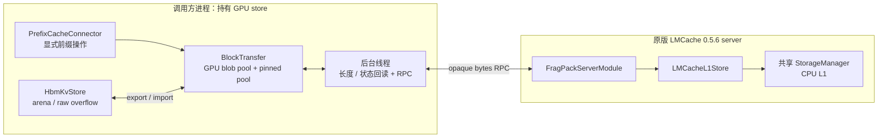
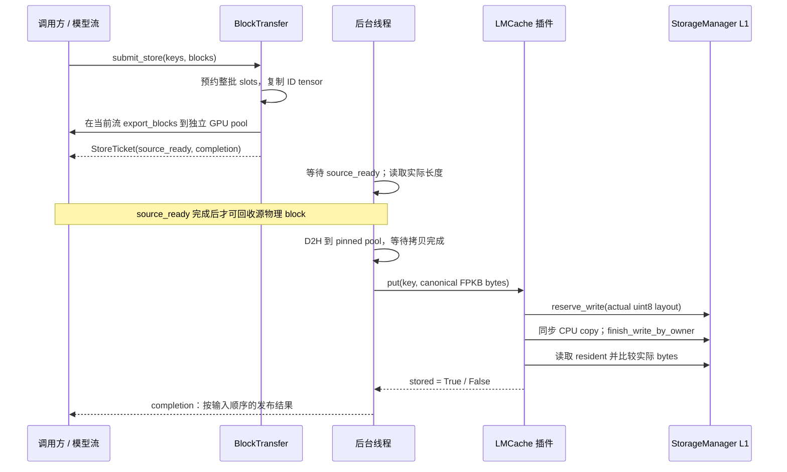
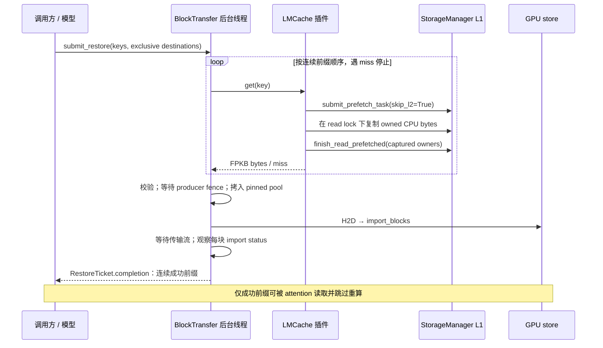

# FragPack 记录的 LMCache 存取

FragPack 通过官方 LMCache `0.5.6` 的外部 server module 接口，把已完成 block
的压缩记录存入 CPU L1，命中时重新装入 GPU。传输使用现有 `FPKB` block blob，
包含一个 TP rank 的全部层；保存时不重新编码，恢复时不先还原整块 BF16 KV。

当前实现是显式的 prefix lookup、store 和 restore API，加上独立后台传输线程。
它已经通过真实 LMCache 内存层和 RPC 的功能验证，但尚未绑定 vLLM scheduler，
也不启用 NVMe/L2 恢复。后续设计见 [接入路线与接口边界](lmcache-roadmap.md)；
安装、启动参数和验证记录见 [接入说明](../lmcache-plugin-056.md)。

---

## 固定版本与组件边界

外部缓存目标固定为官方 LMCache `v0.5.6`，源码基线
`3e11e10812b448142c6cdb177a3058652bd826fa`。CUDA 12.9 的 CPython 3.10 wheel
由 [requirements/lmcache-cu129.txt](../../requirements/lmcache-cu129.txt) 的
URL 和 SHA256 固定。运行期只检查 distribution version 为 `0.5.6`，不能据此
识别另一个安装目录中同版本号的私有补丁。

| 组件 | 所在位置 | 职责 |
|------|----------|------|
| `CacheIdentity` / `BlockKey` | `integrations/lmcache/identity.py` | 模型、表示、码表和分片身份；连续 token 前缀的链式 key |
| `PrefixCacheConnector` | `integrations/lmcache/connector.py` | 把完整 token 前缀映射为显式查找、分批保存和恢复操作；不接管引擎 block 分配 |
| `BlockTransfer` | `integrations/lmcache/transfer.py` | 固定 GPU/锁页内存池、导出事件、后台 D2H/H2D、RPC、导入状态和完成 Future |
| `RemoteBlobClient` | `integrations/lmcache/client.py` | 使用官方 `RequestClient.server_module_call` 发送有界字节消息；管理本客户端的不确定 RPC 状态 |
| FPKB / RPC 校验 | `integrations/lmcache/protocol.py` | 检查 envelope、实际长度和身份，规范化未定义 padding；编解码 `FPLM` 消息 |
| `FragPackServerModule` | `integrations/lmcache/server.py` | 通过官方 factory 加载，注册 `fragpack.blob.v1`，解析 `put/get/lookup` |
| `LMCacheL1Store` | `integrations/lmcache/storage.py` | 通过公开 StorageManager API 预约实际长度、同步 CPU 拷贝、确认发布和释放读锁 |
| `HbmKvStore` | `ops/hbm_kv.py` | GPU 记录、arena/overflow、`export_blocks` / `import_blocks`；不依赖 LMCache |
| LMCache `StorageManager` | LMCache server | L1 对象、分配、驻留、淘汰和原有租约机制；仍由 LMCache 所有 |

表中 FragPack 路径均相对 `fragpack/`。表示和 GPU 核心不导入 LMCache、DaseR 或
外部存储策略。导入 `fragpack.integrations.lmcache` 也不初始化 CUDA 或加载
LMCache；使用远程 client / server factory 时才要求固定的外部依赖。



当前没有 CUDA IPC、零拷贝或直接 NVMe-to-GPU DMA。LMCache server 接收自己拥有的
CPU bytes，再同步写入 L1；GPU DMA 不直接指向可能过期的 LMCache reservation。

---

## 前缀身份与命中语义

`CacheIdentity.namespace` 是以下字段的规范 JSON 的 SHA256：FPKB 格式和版本、
128-token block、128 维 head、`model_revision`、有符号 int64 `table_digest`、
层数、当前 rank 的 KV head 数、`rank` 和 `world_size`。`model_revision` 必须
由调用方区分影响 KV 的模型权重、adapter、位置编码和 attention 配置，不能只用
一个可变模型别名。

`block_keys()` 在 CPU 上处理完整的 token 序列。初始 hash 包含 namespace 和
tenant salt，之后每个完整的 128-token block 在上一个 hash 上继续链式计算；
token 以 little-endian uint64 编码。不满 128 token 的尾部只校验 token 值，不
产生外部 key。修改前部 token 会改变本 block 以及后续所有 block 的 key。

每个 `BlockKey` 保留 `namespace`、`prefix_hash` 和独立 `cache_salt` 字段。
salt 最长 128 字符，不接受 `@`、`/`、反斜杠或 NUL。LMCache `ObjectKey` 映射为：

| 字段 | 值 |
|------|----|
| `chunk_hash` | `prefix_hash` 的 32 字节表示 |
| `model_name` | `fragpack-` 加 namespace |
| `kv_rank` | `CacheIdentity.rank` |
| `object_group_id` | `0`，整个 all-layer blob 是一个字节对象 |
| `cache_salt` | 保留原 salt |

`lookup_prefix()` 只返回从第一个 key 开始的连续命中数。遇到缺失立即停止，不能
越过一个缺口复用更后面的块。远程 lookup 每次最多发送 32 个 key，长前缀分组查询；
命中后会释放 L1 读锁，因此结果只是当时的可用性提示，不为后续 restore 保留驻留。

`PrefixMatch.token_count = 128 * len(keys)`。调度器只有在后续 restore 成功后
才能跳过这些 token 的计算，不能仅凭 lookup 命中提前宣布恢复成功。分片隔离的 key
也不等于 TP 多 rank 的一致发布或一致恢复；当前验证范围为 TP=1。

---

## Block blob 与 RPC 布局

一个 FPKB blob 保存一个完整 block 的全部层，按 4 KiB 对齐。设 `L` 为层数、
`H` 为本 rank 的 KV head 数：

| 偏移 | 内容 |
|------|------|
| `0` | u32 magic `0x424B5046`、u32 version `1`、u32 `L`、u32 `H` |
| `16` | i64 逻辑字节数：head 加全部记录，不含末尾对齐 padding |
| `24` | i64 码表 digest，与 `HbmKvStore.table_digest` 一致 |
| `32..63` | 保留字节，外部传输前清零 |
| `64` | i32 `rec_len[L, 2, H]`，保存各记录可变部分长度 |
| `head` | 按 `(layer, K/V, head)` 紧排的记录，每条为 `22528 + rec_len` 字节 |

```text
head = round_up(64 + 8 * L * H, 4096)
logical_bytes = head + sum(22528 + rec_len)
stored_bytes = round_up(logical_bytes, 4096)
max_blob_bytes = head + 2 * L * H * 32768
```

池中的 `blob_stride` 使用 all-raw 上界，实际 D2H、RPC 和 L1 对象使用
`stored_bytes`。普通压缩记录的可变部分为 48 到 2048 字节且按 16 字节对齐；raw
记录为 `32768 - 22528`。校验器检查 magic、版本、层/head 数、码表、每条长度、
长度总和和最终 padded extent，不接受截断或额外尾随字节。

原生 export 不写保留 header、head 内空隙和末尾 padding。`canonicalize_blob()`
先校验，再在 CPU 上将这些区域清零，既避免传出旧 allocator 内容，也避免同一组
记录因未定义字节不同而被误判为冲突。实际编码记录的内容保持逐字节不变。
这里没有额外的 payload checksum，也不验证任意编码符号的语义正确性；GPU import
状态仍然是恢复可用性检查的一部分。

RPC 使用 `FPLM` version `1` 的 `<4sIIQ` frame，后接 JSON metadata 和原始 bytes。
header 上限为 64 KiB，payload 上限由接收方的 `identity.max_blob_bytes` 决定。
解析器拒绝重复 JSON 字段、非有限数值、错误类型、截断和尾随数据，不使用 base64。
namespace 用于缓存身份隔离，不提供网络认证；部署使用受信任的本地 endpoint。

---

## 保存流程与两个完成点

调用方在模型所属线程的当前 CUDA stream 上提交保存，将 export 排在所有层的
encode 和本步 commit 之后即可，不需要先让 CPU 同步等待编码。物理 block ID
必须有效且互异；接口检查 dtype、device、维度
和连续性，但不为验证 ID 数值在热路径读回 GPU。



`source_ready` 记录在本批所有 export 之后；事件完成才表示源数据已经进入
FragPack 自己拥有的 GPU pool，记录事件本身不等于完成。它不表示 D2H 完成，
也不表示对象已在 LMCache 中可见。后台 worker
负责 event wait、长度回读、传输和阻塞 RPC，不在每层 attention 中执行这些工作。

server 先检查是否已有相同 canonical bytes：相同则视为幂等成功，不同则报告 key
冲突。新对象按实际 padded 长度预约一维 CPU `uint8` tensor。`reserve_write`
拒绝时返回 False；由于 stock `finish_write_by_owner()` 没有逐对象结果，插件必须
再次读取 resident 并确认字节一致才报告 True。确认不到对象时无法区分发布失败和
立即淘汰，返回 False 并停用该存储适配器，不推断为成功。

一个 store batch 按 key 顺序发布，遇到 False 后不再发布后续块，返回值后缀补
False。抛异常之前可能已经发布了前面的对象，异常不表示整批回滚。已接纳任务的
Future 不可取消，以免把取消等待误当成异步工作已经停止。

---

## 恢复流程与第三个完成点

目标 block 必须已经由引擎分配、不是 open block、没有与 attention 或其他写者
共享，并在整个恢复期间保持归属不变。`submit_restore()` 复制目标 ID，在调用方
当前 stream 记录 producer fence；后台 import 先等待这个 fence。



服务端的 L1 read lock 保持到 owned CPU bytes 拷贝完成，随后释放；RPC payload
和 pinned pool 都有独立所有者，因此不需要把 L1 读锁保持到 GPU attention 结束。
正常读取使用 `read_prefetched_results`，成功路径显式调用
`finish_read_prefetched`；解析失败由原版 context manager 清理读锁。

worker 只取回第一个 miss 之前的 blobs，H2D 后由 `import_blocks()` 安装到目标
arena/overflow。DMA 完成不等于 import 成功：worker 等待流并观察 status，返回的
True 只允许构成连续前缀。某块失败时，它和后续块都不能复用，即使部分层或后续块
已经写入目标。Future 抛异常时，本 ticket 的整个目标集合都不能作为成功恢复使用。

---

## 缓冲区、队列与关闭

每个 `BlockTransfer` 实例有一个后台 worker 和一套共享的 store/restore slots。
默认 `num_slots=2`，GPU 与 pinned host 各预留
`num_slots * store.blob_stride` 字节。它们是传输 pool，不是全历史 BF16 cache，
也不是 unfinished block 的持久 staging；多个 transfer 实例须分别计入预算。
`memory_usage()` 仅报告 `gpu_transfer` 与 `pinned_transfer`，不包含瞬态 RPC
bytes、ID/length/status tensor 或其他 store/attention 内存。

池满或本批块数超过空闲槽数时，整批立即返回 `None`，不提交部分 GPU 工作，也不
在 producer 上等待空位。队列的实际接纳量由 slots 约束。长前缀使用
`store_complete(..., start_block=..., max_blocks=...)` 分批，但每次仍传完整 token
和物理 block 列表，不能截断前部 token 后重新计算 key。恢复分批时也必须在首次
失败后停止后续批次。未满尾块始终留在本地。

ID tensor 的 clone、length tensor、GPU/pinned pool 和 job 都被持有到消费者结束；
保留 ID tensor 不会替代引擎对物理 KV block 的保留。GPU 初始化和提交期间拒绝
CUDA Graph capture。正常等待只发生在 worker 的 producer event 和自有传输流，
不做 device-wide synchronize；提交异常时允许在调用方做必要的 producer drain。

每个 `RemoteBlobClient` 最多有一个在途 RPC。send/wait 异常后保留这个不确定请求，
设置 `failed` 并拒绝后续发送；`.result(timeout)` 本身不会取消底层请求，因此不能
通过无限重试让消息层积累无界 payload。已完成 RPC 的应用层拒绝不会自动停用 client。

关闭顺序是先 `transfer.close(timeout=...)` 停止接纳并排空已接纳任务，再关闭调用方
拥有的 `RequestClient`。close 超时保留 worker 和 buffer 所有权，后续可继续等待，
不能把超时解释成已取消。不能从 worker 自己的 completion callback 调用 close。
server 先关闭插件，再由其所有者关闭共享 StorageManager。

---

## 失败处理与原版 LMCache 边界

| 情况 | 当前处理 |
|------|----------|
| pool 没有足够 slots | 整批拒绝，物理 block 仍由调用方负责 |
| blob 结构或身份错误 | 拒绝传输/发布/恢复，不把无效块作为命中 |
| 可确认 CUDA 已结束的 RPC 或校验异常 | drain 后归还 transfer slots，Future 报异常 |
| 无法确认 CUDA 工作已结束 | 隔离 pool、ID 和 job 所有者，停用 transfer，要求进程恢复 |
| RPC send/wait 超时或异常 | 停用 RemoteBlobClient；调用方关闭底层连接后才能重建 |
| L1 reservation 后结果不确定 | 停用 LMCacheL1Store，不按 key 强制删除其他写者对象，不宣称立即回滚 |
| prefetch wait/query 异常或未完成 | 保留 handle 和 key，停用 store；close 查询已完成结果并释放对应读锁 |
| 未完成 prefetch 永不返回 | stock 没有公开 cancel；最终由共享 manager 关闭处理 |

插件在初始化和每次存取时检查没有 L2 adapter，避免运行期加装 L2 后误进入不支持的
恢复路径。`report_status()` 明确报告 `l1_only=True`、`l2_restore=False`、
`immediate_write_rollback=False`、`reservation_generation_check=False`，并暴露
失败状态和待清理 read handles。

同步 CPU copy 和插件锁只缩短风险窗口，不能改变 LMCache 原有的 write TTL 契约。
stock owner 表示 manager，不是某次 reservation 的代次；长时间暂停的写者可能遇到
过期 staging 被后台回收，普通 Python 引用也不能阻止其空间复用。当前要求
reserve/copy/finish 在原版 write TTL 内完成，不声称对任意跨 TTL 暂停安全。
强保证需要由 LMCache 提供带 generation 的 reservation、buffer pin 与匹配的
finish/cancel 接口，详见 [后续边界](lmcache-roadmap.md)。

## 验证范围

当前已有 CPU 合约测试、官方 0.5.6 的真实 CPU L1/ZMQ 测试，以及 GPU 导出 →
真实 RPC/L1 → GPU 导入的逐位恢复验证。具体版本、计数和日志见
[2026-10-30 接入验证](../lmcache-plugin-056.md)。
这些结果不代表 full-model serving、NVMe 恢复、TP>1、transfer CUDA Graph 或
端到端性能收益。attention 如何消费导入记录仍由
[HBM 常驻压缩 KV](hbm-resident-kv.md) 中的默认 gather/FA3 或实验 fused 路径决定。
