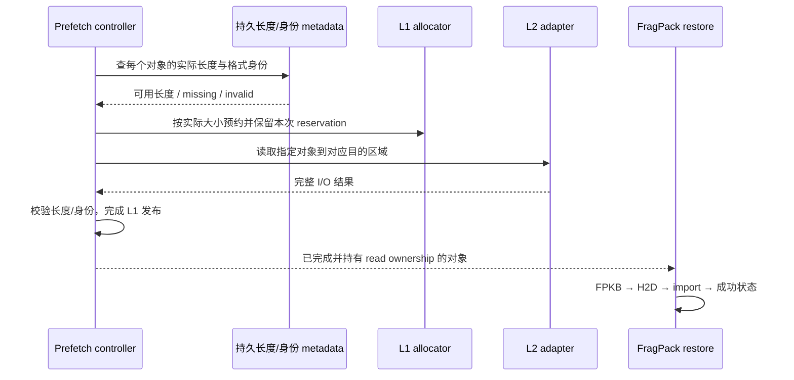

# LMCache 接入路线与接口边界

本文记录本轮暂停外部缓存接入工作时已经确定的路线，便于以后继续。当前已实现的
CPU L1 插件、显式前缀 API 和有界传输队列见
[FragPack 记录的 LMCache 存取](lmcache-integration.md)。下面涉及的 vLLM 调度接线、
L2 恢复和强租约保证均未实现，不能按可用配置启动。

设计目标保持为：GPU 保存和计算 FragPack 记录，LMCache 管理外部容量和驻留；
跨层传输继续使用 FPKB，不为了适配普通 KV connector 重新构造一套全历史 BF16
cache。固定官方 LMCache `0.5.6`，以后升级须重新核对公开接口、数据布局和验证。

---

## 能力归属

| 能力 | 归属与当前状态 | 是否必须修改 LMCache |
|------|----------------|----------------------|
| 记录格式、GPU export/import、raw overflow | FragPack 核心，已存在 | 否 |
| prefix identity、实际长度校验、有界后台传输 | FragPack integration，已实现 | 否 |
| CPU L1 的实际长度预约和存取 | FragPack server module 调用公开 API，已实现 | 否，但沿用 stock TTL 限制 |
| vLLM 请求/物理块生命周期与调度完成事件 | 后续 FragPack-owned adapter | 不必然；可在外部 adapter 中报告自己的完成事件 |
| 原生 L2 prefetch 在分配前取得每对象长度 | LMCache StorageManager/controller/L2 metadata 的跨层契约 | 保持原生对象和 prefetch 流程时需要修改 |
| 跨 TTL 的安全 buffer 生命周期、准确取消和逐对象完成 | LMCache reservation/lease 与 allocator 契约 | 需要 LMCache 提供 generation 和 pin/finish/cancel 能力 |
| 使用 stock engine/router 的后台完成事件 | stock engine/router 的事件时机 | 若坚持使用这些内建事件，需要适配其语义；自有 adapter 可以避免这项修改 |

这里的边界不是“所有变长存储都必须 fork LMCache”。可以另设计 manifest 或固定页
协议，但它会改变对象数量、读写路径和发布事务，本轮没有把它当作现成替代实现。
同样，替换整个存储后端会把驻留和恢复责任转到 FragPack，不能再声称完整复用
LMCache 原生存储流程。

---

## vLLM 接线：把显式 API 绑定到真实请求

`PrefixCacheConnector` 当前是调用方 API，不是 `KVConnectorBase_V1` 实现。
安装 LMCache server module 或把普通 `LMCacheMPConnector` 配到 FragPack arena
上，均不会自动得到正确的 prefix reuse。后者按 dense KV layout 搬运，不能替代
携带记录长度、overflow 和码表身份的 FPKB。

接线时仍把 representation/GPU store、引擎适配、外部缓存三个边界分开：

1. scheduler 使用真实 token 前缀和对应身份进行 lookup，协调本地 APC 与外部命中，
   不把本地共享块作为 import 可写目标。
2. worker 接收已分配的独占目标，连接 producer fence、H2D、import 和状态检查。
   lookup 或 H2D 完成均不能提前触发“load finished”。
3. all-layer 完成后才能保存整个 block。每层 attention 后的单层回调不是 all-layer
   FPKB 的可用导出点；初始接线优先使用 post-forward/all-layer completion。
4. 保存期间保留源 block 至 `source_ready`，再允许引擎回收；外部缓存可见性由另一个
   publication Future 决定。不要让后台 RPC 的延迟强制延长源 block 的保留时间。
5. import 失败、外部淘汰或部分前缀恢复不足时，只接受连续成功前缀，其余由引擎重算。
   request cancellation、preemption 和 shutdown 也必须沿用相同所有权规则。

所有 device 长度/status 观察和网络等待仍留在后台，不能塞回每层 attention。
首先验证 TP=1 eager；TP 多 rank 的命中数取舍、一致发布和失败处理需要另行设计。
当前 key 带 `rank/world_size` 只解决隔离，不解决跨 rank 协议。

---

## L2 恢复：先知道长度，再分配空间

FPKB 不同 block 的实际长度不同。stock 0.5.6 可以在写入时按单对象的实际 layout
预约 L1，但标准 prefetch 的目标分配来自 group layout；L2 lookup 并未向这条路径
提供足够的逐对象尺寸信息。用 `max_blob_bytes` 代替实际大小，不能证明实际存储
长度、I/O 长度和目的 buffer layout 一致，也会掩盖容量收益。

计划中的原生恢复流程是：

长度与格式 metadata 必须满足：

- L1 淘汰后仍能发现尺寸；不能只保存在“本进程刚写过什么”的字典里。
- 支持的重启模型要明确：若承诺重启恢复，数据和长度必须一起持久化并可恢复一致状态。
- 每个 L2 backend 明确如何得到尺寸，以及部分写入、缺失、截断和错误身份如何失败。
- 数据和 metadata 完成之前不能发布命中；失败后取消的必须是本次预约，不能删除后来
  同 key 的有效对象。

此前 `daser-codec` 的 `stored_object_sizes`、size-aware prefetch 和 native adapter
size map 提供了接口参考，但它的进程内 `_key_sizes` 不能直接作为持久恢复方案。
Python filesystem adapter 与 native filesystem adapter 也不能互相替代验证。
该分支使用 DaseR 的 BF16 编码/解码路径，不能直接接到 FragPack arena；详见
[参考迁移评审](../lmcache-daser-codec-review-20261030.md)。

### 不改原生 prefetch 的替代方案

| 候选 | 可以绕开的部分 | 必须付出的代价 |
|------|----------------|----------------|
| manifest 对象先查长度 | 由外部协议先发现数据尺寸 | 增加 metadata 读取；需处理 manifest/data 的原子可见性、独立淘汰和重启一致性 |
| 固定页或 size class | 使用固定 layout 对象承载可变 blob | padding/内部碎片，或一个 blob 对应多个对象；需拼接、完整性检查和多对象发布/清理 |
| 单独存储实现 | 不使用原生 SM 的恢复分配流程 | FragPack 接管更多分配、驻留、淘汰与持久化职责；维护面扩大 |

这些候选尚未选型或实现。继续工作时先根据实际 payload 分布与需要支持的 backend
比较代价，不能仅凭理论压缩率决定。

---

## 预约过期、取消与内存安全

stock `prepare_write_completion()` 捕获的 owner 标识 manager，并不唯一标识某次
write reservation。write TTL 到期后，同 key 的新写者可能得到新的或复用的 staging；
后台 eviction 也可能回收旧 staging。旧写者手上的普通 Python tensor 引用不能
延长 LMCache allocator 的租约。

因此“增加按 owner 删除”还不够：旧任务完成或取消时，必须证明它操作的仍然是
自己的那一次预约。后续所需契约至少包括：

| 契约 | 要解决的问题 |
|------|--------------|
| reservation generation / lease token | 区分同 manager、同 key 的不同写入代次 |
| 显式 buffer pin 或等价生命周期保证 | CPU copy / DMA 使用期间，后台不能把区域分配给其他对象 |
| 与 generation 匹配的 finish / abort | 旧任务不能发布或取消新写者的结果 |
| 逐对象完成结果 | 区分本次写入成功、拒绝、过期和失败，不能把无返回值当成功 |
| prefetch cancel / owner 清理契约 | 未完成读取的句柄和读锁在取消、超时、关闭时有确定归属 |

当前插件把 D2H 先写进自己拥有的 pinned pool，server 再同步 CPU copy 到 L1，避免
CUDA DMA 长时间使用可过期 reservation；不确定结果会停用 client/store，并检查
实际 resident bytes 才报告发布成功。这些保护不能提供任意跨 TTL 暂停的强保证。
验证新接口时必须主动制造暂停超过 TTL、同 key 新写者、并发 eviction、部分提交失败
和取消后 DMA 仍在进行的情况，而不只测试编码前的异常。

---

## 后续优化与验收顺序

下一阶段先补齐请求级接线和明确的失败恢复，再考虑扩大吞吐。以下阶段是继续外部
缓存工作时的顺序，不代表已有实现或新的实验结果。

| 阶段 | 验收内容 | 证据要求 |
|------|----------|----------|
| L1 serving | 外部命中真正跳过计算，未满尾块留本地，正确处理取消/preemption、重复保存和本地 APC | 清除 GPU 本地前缀后证明实际外部读取、成功 import 和正确请求结果；不能只看 lookup 计数 |
| L2 尺寸与租约 | 完成逐对象长度发现、原生分配、持久化和强所有权协议 | 先 CPU 故障注入，再小规模 GPU；覆盖失败清理和承诺支持的重启模式 |
| L2 全路径 | 强制 L1 miss，确认 L2 read、L1 promotion、GPU import，下一轮 L1 reuse | 分开记录 L1/L2 命中来源、实际读写字节和完成状态 |
| 公平对照 | 同模型、相同 serving 参数和可解释的容量预算下对比 BF16 与 FragPack | cold miss、L1 hit、L2 hit 分开；报告 TTFT、吞吐、传输字节和所有辅助内存 |
| 扩展范围 | TP>1、完整模型 CUDA Graph、跨引擎共享或直接存储 DMA | 单独设计与验证，不从 TP=1 eager 功能通过推导支持 |

性能探索围绕已识别的代价展开：有效 L1/L2 驻留容量、export/import 开销、RPC 与 CPU
bytes 拷贝、保存与恢复的排队干扰，以及有限 transfer slots 的接纳策略。当前一个
worker 处理一套 slots、一个 remote client 串行 RPC，是清晰可验证的起点，不代表
高并发最优实现。调整 batch、分离 store/restore worker、减少重复搬运或更换传输方式
之前，应先测量这些环节各自占比，并保留原有完成点和所有权约束。

报告内存时把 arena、unfinished-block staging、scratch、overflow、attention
workspace、GPU transfer pool、pinned transfer pool、CPU RPC copies 和 L1/L2
实际对象占用分开。编码更快、blob 更小或单层 kernel 更快，均不能直接作为 serving
TTFT/TPOT 改善的结论。原始版本选择、候选方案和验收动机保留在
[初始接入目标](../lmcache-integration-target-20261030.md)。
