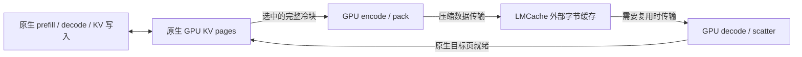

# 原生 attention 与外部 KV 压缩：研究方案

状态：**独立 codec 往返及两轮优化已验证，尚未接入模型服务**。2026-10-30 从
`feat/lmcache-056-plugin` 的 `9edec04` 创建研究分支
`feat/native-attention-external-codec`。新增独立 native-page codec，已完成逐位测试和
真实 pinned-host D2H/H2D 对比；见[实验记录](../optimization-native-codec-20261030.md)。
另已完成与 gather＋FA3、fused prefill 的
[48 层只读对照](../comparison-native-codec-prefill-20261031.md)，覆盖驻留读取和外部恢复后读取。
现有 HBM 常驻压缩路径保持不变。

## 判断与目标

如果产品目标是可接入 vLLM、LMCache 的编解码插件，优先研究这条路线：
**活跃 GPU KV 保持原生 BF16，只有迁出到外部缓存的 KV 才压缩。**
prefill、decode、KV 写入、attention backend 和 kernel 全部由原生 vLLM 执行。
FragPack 仅在外部保存与恢复边界工作，不接入现有 CUSTOM attention 或 runner 包装。

这能缩小适配边界，避免在每个 decode step 解压历史 KV，但不能扩大同一时刻
活跃请求的 GPU KV 容量，也不解决单个请求的 raw KV 放不下的问题。
无活动引用的 APC 块本来就可被 vLLM 回收；迁出它们的主要价值是避免历史丢失后重算。
收益应表述为外部历史容量、实际传输量及复用时的延迟，不能沿用原 HBM 压缩的容量结论。

## 冷数据的定义与处理

对 full attention，活跃请求的历史 KV 每个 decode step 都要使用。
token 较早或某一步 attention 权重较小，不构成无损卸载的理由。
首版以**无活动引用、内容完整且不可变的 APC 块**为候选。
整个已暂停请求是后续场景，必须由引擎确认暂停和恢复，不能自行释放其页。

| 状态 | 建议行为 |
| --- | --- |
| 任一活跃请求仍引用的 KV | 留在原生 GPU cache；不加入冷块迁出候选 |
| 无活动引用，近期可能再用，GPU 暂无压力 | 保留原生 APC 命中机会，推迟编码和传输 |
| 接近被回收，未来复用或重算价值较高 | 保护源页，压缩并外存；源读取结束后允许 GPU 页回收 |
| 外部已经有有效不可变副本 | 不重复编码和上传；按引擎规则回收 GPU 页 |
| 几乎不会复用、重算很便宜 | 丢弃，不为所有冷数据支付保存成本 |

冷表示当前不活跃，不等于应当永久保存。选择还要考虑预计复用、重算成本、
可用的连续前缀、链路压力和在途预算。不能只保存任意中间块并假定能跳过前缀缺口。
恢复后在请求活跃期间继续使用 raw GPU KV；保留外部副本，避免再次淘汰时重新上传。
外部存在性查询只是瞬时信息：普通缓存丢失可回退重算，可靠暂停恢复则需要租约或驻留保证。

## 已核验的接入条件

- 当前安装的 vLLM `0.30.0+cu129` 提供原生 KV 张量注册、批级加载与完成通知、
  block pool 绑定及引用保护。相关 connector、scheduler、block pool 和 V2 connector
  文件与安装包 `RECORD` 哈希一致；这是源码核验，不是本方案的运行验证。
- `KVConnectorBase_V1.bind_kv_cache_manager` / `bind_gpu_block_pool` 可接入页生命周期；
  `request_finished` 与完成通知可实现延迟释放。
  原版 `v1/simple_kv_offload/manager.py::_prepare_lazy_store_specs` 已从 free queue
  选择接近淘汰的缓存块，通过 `touch` 持有引用，在复制结束后释放。
- 固定的 LMCache 0.5.6 commit `3e11e10812b448142c6cdb177a3058652bd826fa`
  已有 `LazyOffloadManager`，支持 `EVICTION_AWARE` 和 `FIFO`。
  开启 lazy offload 后默认采用前者；未开启时仍走普通保存路径。
  其策略会核对候选块身份和前缀连续性，manager 对提交的保存任务持有引用。
  参见[固定版本策略工厂](https://github.com/LMCache/LMCache/blob/3e11e10812b448142c6cdb177a3058652bd826fa/lmcache/integration/vllm/lazy_offload_policy/__init__.py)、
  [策略实现](https://github.com/LMCache/LMCache/blob/3e11e10812b448142c6cdb177a3058652bd826fa/lmcache/integration/vllm/lazy_offload_policy/eviction_aware.py)
  与[官方功能说明](https://docs.lmcache.ai/mp/lazy_offload.html)。

因此，冷块/延迟迁出本身是已有机制。优先利用 LMCache 的调度能力，FragPack 提供 codec；
不重做一个缓存系统，也不将“只迁出冷块”单独当作新贡献。
当前 FragPack LMCache 插件尚未接通这条 scheduler/worker 路径，不能只改配置就运行。
原版 raw offload 是生命周期参考和比较基线，其固定 dense 存储不能直接承载变长 FPKB。

首版采用批级保存与恢复，逐层回调不承载工作。原版逐层 Python 回调对 FULL CUDA Graph
有额外限制；采用批级接口也仍需单独验证 graph、取消和抢占，不能据此宣称已兼容。

## 需要新增的边界

可复用 BF16 位级编码、码表、raw fallback、FPKB 格式校验、解码原语、
前缀身份和现有 LMCache 字节服务/有界队列。独立原型现已提供两个 GPU 接口：

1. **native pages → compressed blob**：按选中 block 的实际布局和 stride
   直接读原生 KV，编码、计算长度并紧排输出。
2. **compressed blob → native pages**：校验记录并解码，直接 scatter 到引擎分配的原生页。

现有 [HbmKvStore.export_blocks/import_blocks](../../fragpack/ops/hbm_kv.py)
只在已有压缩 arena 与 blob 之间传递；[gather](../../fragpack/ops/hbm_kv.cu)
已有解码与布局还原原语。新增的 [NativeCodec](../../fragpack/ops/native_codec.py)
通过独立 extension 提供上述接口，不调用这些 HBM store 入口。
不应为了使用 codec 再建立 `HbmKvStore`、prepare 状态、open-block staging 和压缩 arena。
core 只接受布局描述、页映射、张量、码表与输出缓冲；缓存准入和 LMCache RPC 留在 integration。

首版保留现有 BF16、128-token record、head_dim=128 的 codec 范围。
原生物理页可能采用不同大小/布局，adapter 必须显式映射，不假定一个 record 就是一页。
先复用格式，再测其为 fused attention 设计的排列在独立 codec 中是否产生明显成本。

可以省掉完整 BF16 中间 workspace，但仍需有界的压缩输出、长度/status 元数据和 pinned
传输区。变长编码首版可采用临时记录槽加压紧；需要核算额外 GPU 访存、长度观察、
CPU copies、RPC 和对齐。变长传输需要观察输出长度；采用事件保护的少量异步元数据回传，
将复制和等待计入成本，不在热路径引入全设备同步。
23.25 KiB / 32 KiB 是旧 arena 的记录预算几何，**不是外部压缩比**；
必须统计含 header、对齐和 fallback 的实际存储与传输字节。

## 所有权与执行顺序

1. 候选排队只保留身份元数据；真正提交前复核 hash/代次、完整性与可用前缀，取得源页引用。
   等待源 KV 写入完成，再让 codec stream 读取。候选已被复用则放弃，不能读取旧页号。
2. 源页一直保持有效，直到编码读取完成。之后可释放 codec 自己持有的引用；
   输出 blob 由传输队列继续持有，外部数据发布成功是另一个完成点。
3. 恢复时由引擎分配目标页，禁止覆盖仍被共享使用的页。
   压缩 H2D 完成后还需解码、校验成功；**目标 raw KV 就绪**才允许上报加载完成和跳过 prefill。
4. 候选/在途数、源页 pin 数及 GPU/pinned 缓冲都设上限，防止后台保存反而耗尽可用页。
   首版提前选择并显式 pin；不在物理页即将覆盖时才启动编码。
   复用通知本身不会自动阻止覆盖，zero/COW 等路径也不能靠一个 attention 前的 fence 泛化处理。
5. 格式、码表身份、范围或状态失败时不得发布可用前缀；在安全释放任务资源后走重算。
   外部已保存的块应在编码前去重；当前服务端 `put` 去重发生在传输之后，尚不能省掉这部分工作。

## 成本判断与最小验证顺序

对相同数据范围、一次存出与一次取回，串行成本的粗略盈亏条件是：

`encode + decode + 额外打包/控制成本 < (raw字节 - 压缩字节) × (1/存出带宽 + 1/取回带宽)`

使用实际批量下的有效带宽和传输字节；这是与 raw offload 的比较，不是端到端加速预测。
异步重叠可能隐藏延迟，但仍占用 GPU、HBM 和链路。与直接丢弃相比，还要看预期复用节省的
prefill 是否覆盖保存与恢复成本；与 GPU 命中相比，应尽量避免迁移。

按以下顺序验证，目前第 1 步已完成，后两步待接入：

1. 独立 codec：多层 raw pages 的逐位往返，包含 fallback、不同页映射和非法记录；
   分开测编码、紧排、实际 D2H/H2D、解码 scatter 和总耗时。
2. 原生服务：BF16 KV、TP=1、full attention，先 eager；验证 prefill、decode、
   APC/外部命中、源保护和失败重算。确认未加载 CUSTOM backend 或当前 runner 包装。
3. 在相同模型、预算、请求序列和缓存规则下比较 raw/压缩 × 即时/延迟 offload，
   另保留原生 APC 参考。用全热 GPU 命中、间歇会话复用和超出 GPU 历史容量的负载区分收益来源。
   总预算包含 codec 与传输缓冲，不只比较 payload。

重点记录实际迁出/恢复次数与字节、重复上传、保存后未复用的数据量、连续前缀命中、
后台资源开销、pin 等待、TTFT/TPOT 尾延迟和吞吐。热负载应尽量不触发 codec；
压缩必须在相同 lazy 策略的 raw 基线上证明净收益。
现有 LMCache 插件的 L2/NVMe 尚未打通，不将 SSD 收益列为已验证能力。

## 独立原型的实施合同

`ops/native_codec.py` 注册各层原生 BF16 张量，逻辑维度为
`[2, physical_pages, page_tokens, KV_heads, 128]`，允许非连续、无重叠的正 stride。
初始化阶段保存张量所有权，并把地址与 stride 描述上传 GPU；整个注册对象生命周期内
不得 resize 或重新绑定其底层存储，布局变化后应重新注册。
原生页大小支持 16/32/64/128，每个 128-token codec block
由显式 page map 指定，不要求原生页物理连续。目标 page map 不允许重复页。

基线分为原生页编码到有界 record 槽、长度/偏移规划、批内 FPKB 紧排三个阶段。
FPKB v1 和原有 raw fallback 保持不变，批内每个 blob 按 4096 字节对齐，
reserved/padding 清零。恢复先校验 blob 和记录边界，再直接写目标原生页。
原始路径使用同一映射进行 raw gather/scatter；比较包含两条路径各自的布局处理。

core 接口均向当前 CUDA stream 提交工作，返回设备端状态，0 表示成功；不执行 host
同步或热路径 readback。调用方负责跨 stream 的 producer/consumer event 和所有对象生命周期。
一个 codec workspace 同时只服务一个批次，前一批使用完成前不能复用；工作区不承担缓存策略。
主机阶段检查禁止未编码就规划或未规划就打包，避免读取未初始化的偏移；检查不等待 GPU。
实际变长传输由 benchmark 使用 pinned metadata 异步获取有效长度，计入完成等待和传输字节；
恢复时也重新上传保存的 offsets，不借用未传输的 GPU payload 作为外部往返结果。

本轮在同一块 H800 PCIe 上完成基线与两次观测驱动的优化，比较真实 pinned-host
D2H/H2D 的 raw 和压缩路径。校准/评估输入及历史捕获方式保留在结果 provenance 中。
逐位正确性、GPU stream 分阶段时间、host 完整往返和辅助内存分别报告；不据此推断 TTFT。

2026-10-31 的[扩大规模对照](../comparison-expanded-codec-20261031.md)进一步覆盖
28 组48层读取配置与12组完整往返配置，各自完成两个独立进程。Native 的驻留 prefill
读取更快，现有 fused decode 在单 token 读取中更快；冷恢复与重复复用需要分别判断。
当前独立 codec 仍保留编码 scratch 和最大 blob 缓冲，不能把 payload 减少直接当作
GPU 总容量收益。外部服务接线、冷块选择和完整模型端到端验证仍属于上述后续步骤。
