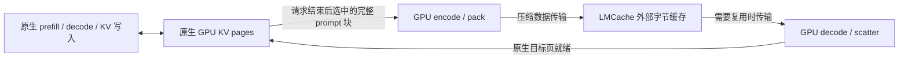

# 原生 attention 与外部 KV 压缩：研究方案

状态：**独立 codec、LMCache CPU L1 传输与原生 vLLM connector 已实现；小模型功能
和有限协议主模型对照已完成**。2026-10-30 从
`feat/lmcache-056-plugin` 的 `9edec04` 创建研究分支
`feat/native-attention-external-codec`。新增独立 native-page codec，已完成逐位测试和
真实 pinned-host D2H/H2D 对比；见[实验记录](../optimization-native-codec-20261030.md)。
另已完成与 gather＋FA3、fused prefill 的
[48 层只读对照](../comparison-native-codec-prefill-20261031.md)，覆盖驻留读取和外部恢复后读取。
现有 HBM 常驻压缩路径保持不变。2026-11-01 新增的原生模型路径使用
`NativeBlockTransfer` 和 `FragPackNativeConnector`，通过 Qwen3-0.6B、TP=1、
eager、原生 FA3 与真实 CPU L1 的冷请求、本地命中、外部恢复及前缀修改功能检查。
随后完成[固定预算主模型 Raw/压缩对照](../validation-native-codec-serving-20261101.md)，
范围为原生 FA3、TP=1、eager、真实 CPU L1 和离线串行回放。总请求及发布窗口改善
不等于 TTFT 加速，W18 外部恢复 TTFT 反而高于重算。HTTP、NVMe、TP>1 和
CUDA Graph 仍未验证；HBM 路线的 scheduler connector 仍待实现。
详细接口和执行边界分别见
[传输合同](native-lmcache-transfer.md)、[vLLM 接线](native-codec-vllm-connector.md)、
[编码前查询](lmcache-probe.md)及[验证协议](native-codec-serving-validation.md)。

## 判断与目标

当前主线是可接入 vLLM、LMCache 的压缩编解码插件：
**活跃 GPU KV 保持原生 BF16，只有迁出到外部缓存的 KV 才压缩。**
prefill、decode、KV 写入、attention backend 和 kernel 全部由原生 vLLM 执行。
FragPack 仅在外部保存与恢复边界工作，不接入现有 CUSTOM attention 或 runner 包装。
缓存规则只作为测量压缩成本的固定条件，编码前去重是减少重复工作的辅助优化；
本轮不开发新的淘汰策略或预测预取算法。

这能缩小适配边界，避免在每个 decode step 解压历史 KV，但不能扩大同一时刻
活跃请求的 GPU KV 容量，也不解决单个请求的 raw KV 放不下的问题。
无活动引用的 APC 块本来就可被 vLLM 回收；迁出它们的主要价值是避免历史丢失后重算。
收益应表述为外部历史容量、实际传输量及复用时的延迟，不能沿用原 HBM 压缩的容量结论。

## 当前保存规则与后续可选策略

对 full attention，活跃请求的历史 KV 每个 decode step 都要使用。
token 较早或某一步 attention 权重较小，不构成无损卸载的理由。
当前 connector 在请求正常结束时保存**已经计算完成的完整 prompt 块**；未满尾块和
新生成的输出 token 不作为新的外存对象。Raw 与压缩采用相同保存时机和 LMCache L1
容量策略。vLLM 本地 APC 命中仍优先；保存前的逐对象 probe 和本地在途合并可跳过
已有副本或正在保存的 key，不改变缓存淘汰规则。

接近 GPU 回收时再保存的 lazy offload 是后续可选策略，当前未接入。它需要在保存前
核验源页身份、保护源引用，并判断连续前缀和在途预算；不能仅依据 token 较早来卸载
活跃请求的 KV。整个已暂停请求的可靠恢复同样是后续场景。
不能只保存任意中间块并假定能跳过前缀缺口。
恢复后在请求活跃期间继续使用 raw GPU KV；保留外部副本，避免再次淘汰时重新上传。
外部存在性查询只是瞬时信息：普通缓存丢失可回退重算，可靠暂停恢复则需要租约或驻留保证。

## 已核验的接入条件

- 当前安装的 vLLM `0.30.0+cu129` 提供原生 KV 张量注册、批级加载与完成通知、
  block pool 绑定及引用保护。相关 connector、scheduler、block pool 和 V2 connector
  文件与安装包 `RECORD` 哈希一致。接口源码核验与上述小模型运行验证分别记录。
- `KVConnectorBase_V1.bind_kv_cache_manager` / `bind_gpu_block_pool` 可接入页生命周期；
  `request_finished` 与完成通知可实现延迟释放。
  原版 `v1/simple_kv_offload/manager.py::_prepare_lazy_store_specs` 已从 free queue
  选择接近淘汰的缓存块，通过 `touch` 持有引用，在复制结束后释放。
- 固定的 LMCache 0.5.6 commit `3e11e10812b448142c6cdb177a3058652bd826fa`
  已有 `LazyOffloadManager`，支持 `EVICTION_AWARE` 和 `FIFO`。
  开启 lazy offload 后默认采用前者；未开启时仍走普通保存路径。
  其策略会核对候选块身份和前缀连续性，manager 对提交的保存任务持有引用。
  参见[固定版本策略工厂](https://github.com/LMCache/LMCache/blob/3e11e10812b448142c6cdb177a3058652bd826fa/lmcache/integration/vllm/lazy_offload_policy/__init__.py)、
  [策略实现](https://github.com/LMCache/LMCache/blob/3e11e10812b448142c6cdb177a3058652bd826fa/lmcache/integration/vllm/lazy_offload_policy/eviction_aware.py)
  与[官方功能说明](https://docs.lmcache.ai/mp/lazy_offload.html)。

因此，冷块/延迟迁出本身是已有机制。优先利用 LMCache 的调度能力，FragPack 提供 codec；
不重做一个缓存系统，也不将“只迁出冷块”单独当作新贡献。
当前 `FragPackNativeConnector` 已接通独立 codec 的 scheduler/worker 路径，使用
公开接口在请求结束后保存，在异步恢复完成后允许原生计算；尚未接入上述 lazy 策略。
原版 raw offload 是生命周期参考和比较基线，其固定 dense 存储不能直接承载变长 FPKB。

首版采用批级保存与恢复，逐层回调不承载工作。原版逐层 Python 回调对 FULL CUDA Graph
有额外限制；采用批级接口也仍需单独验证 graph、取消和抢占，不能据此宣称已兼容。

## 已实现的模块边界

可复用 BF16 位级编码、码表、raw fallback、FPKB 格式校验、解码原语、
前缀身份和现有 LMCache 字节服务/有界队列。独立 codec 提供两个 GPU 接口：

1. **native pages → compressed blob**：按选中 block 的实际布局和 stride
   直接读原生 KV，编码、计算长度并紧排输出。
2. **compressed blob → native pages**：校验记录并解码，直接 scatter 到引擎分配的原生页。

现有 [HbmKvStore.export_blocks/import_blocks](../../fragpack/ops/hbm_kv.py)
只在已有压缩 arena 与 blob 之间传递；[gather](../../fragpack/ops/hbm_kv.cu)
已有解码与布局还原原语。新增的 [NativeCodec](../../fragpack/ops/native_codec.py)
通过独立 extension 提供上述接口，不调用这些 HBM store 入口。
不应为了使用 codec 再建立 `HbmKvStore`、prepare 状态、open-block staging 和压缩 arena。
core 只接受布局描述、页映射、张量、码表与输出缓冲；缓存准入和 LMCache RPC 留在 integration。

`NativeBlockTransfer` 在一个后台线程中管理分离的编码/恢复池、producer event、
有效字节传输和状态检查。`FragPackNativeConnector` 负责请求身份、页映射、延迟释放和
恢复完成通知；层内 attention 回调不做编码或 RPC。详见
[原生页传输](native-lmcache-transfer.md)与[connector 生命周期](native-codec-vllm-connector.md)。

压缩传输保持 FPKB v1。Raw 对照使用独立的 FPNR v1 token-major 原始 BF16 封装，
以 `CacheIdentity.representation="native-raw"` 隔离；它不能交给 FPKB core importer。
Raw 通过 native raw gather/scatter 和相同字节服务传输，CPU 封装与实际复制计入成本。
这一对照不代表原版 LMCache 最优的 raw 传输实现。

首版保留现有 BF16、128-token record、head_dim=128 的 codec 范围。
原生物理页可能采用不同大小/布局，adapter 必须显式映射，不假定一个 record 就是一页。
先复用格式，再测其为 fused attention 设计的排列在独立 codec 中是否产生明显成本。

可以省掉完整 BF16 中间 workspace，但仍需有界的压缩输出、长度/status 元数据和 pinned
传输区。变长编码首版可采用临时记录槽加压紧；需要核算额外 GPU 访存、长度观察、
CPU copies、RPC 和对齐。变长传输需要观察输出长度；采用事件保护的少量异步元数据回传，
将复制和等待计入成本，不在热路径引入全设备同步。
23.25 KiB / 32 KiB 是旧 arena 的记录预算几何，**不是外部压缩比**；
必须统计含 header、对齐和 fallback 的实际存储与传输字节。

## 所有权与执行顺序

1. 当前 finish-time 路径在 scheduler 的 `request_finished` 中取得延迟释放责任，
   将完整 prompt key 和物理页映射送给 worker。这些页在后台 probe 期间也被保留，
   该等待计入开销；不声称已经实现无 pin 的冷块候选队列。
   worker 记录 producer event，后台等待源 KV 写入完成后才能读取。
2. 源页一直保持有效，直到编码读取完成。之后可释放 codec 自己持有的引用；
   输出 blob 由传输队列继续持有，外部数据发布成功是另一个完成点。
   全部批次的 `source_ready` 成功后报告源释放；未完成发布通过 worker metadata
   保持引擎空步进，finish 通知只保留已接纳保存任务的有界子集。
3. 恢复时由引擎分配目标页，禁止覆盖仍被共享使用的页。
   压缩 H2D 完成后还需解码、校验成功；**目标 raw KV 就绪**才允许上报加载完成和跳过 prefill。
4. 候选/在途数、源页 pin 数及 GPU/pinned 缓冲都设上限，防止后台保存反而耗尽可用页。
   首版提前选择并显式 pin；不在物理页即将覆盖时才启动编码。
   复用通知本身不会自动阻止覆盖，zero/COW 等路径也不能靠一个 attention 前的 fence 泛化处理。
5. 格式、码表身份、范围或状态失败时不得发布可用前缀；在安全释放任务资源后走重算。
   NativeBlockTransfer 默认在编码前执行 `probe_many` 并合并同 key 在途任务。
   原 `HbmKvStore` transfer 的服务端 `put` 去重仍是独立路径，不能混作本次提前去重。

## 成本判断与最小验证顺序

对相同数据范围、一次存出与一次取回，串行成本的粗略盈亏条件是：

`encode + decode + 额外打包/控制成本 < (raw字节 - 压缩字节) × (1/存出带宽 + 1/取回带宽)`

使用实际批量下的有效带宽和传输字节；这是与 raw offload 的比较，不是端到端加速预测。
异步重叠可能隐藏延迟，但仍占用 GPU、HBM 和链路。与直接丢弃相比，还要看预期复用节省的
prefill 是否覆盖保存与恢复成本；与 GPU 命中相比，应尽量避免迁移。

当前验证按组件、模型功能和主模型性能分层：

1. 独立 codec：多层 raw pages 的逐位往返，包含 fallback、不同页映射和非法记录；
   分开测编码、紧排、实际 D2H/H2D、解码 scatter 和总耗时。
2. 原生模型功能：Qwen3-0.6B、BF16 KV、TP=1、eager、FA3 与真实 CPU L1 已通过
   冷请求、GPU APC、清除 GPU 前缀后的外部命中及修改前缀检查。生命周期的失败/取消
   CPU 测试与该模型 smoke 分开报告，不推导全面故障或 HTTP 服务验证。
3. 主模型的有限协议对照已完成。在相同模型、预算、请求序列和 finish-time 保存规则下
   比较 Raw/压缩，覆盖 GPU 热命中、间歇复用和超过 GPU 容量的历史工作集。
   总预算包含 codec 与传输缓冲，总请求计时包含保存发布排空。
   关闭提前 probe 的小消融使用
   同一份不可变 KV 的受控往返，不把独立重算的相同 token 误当作必然逐位相同的 KV。

重点记录实际迁出/恢复次数与字节、重复上传、保存后未复用的数据量、连续前缀命中、
后台资源开销、pin 等待、TTFT/TPOT 尾延迟和吞吐。热负载应尽量不触发 codec；
压缩必须在相同保存和淘汰规则的 Raw 基线上证明净收益。
现有 LMCache 插件的 L2/NVMe 尚未打通，不将 SSD 收益列为已验证能力。

## 独立原型的实施合同

`ops/native_codec.py` 注册各层原生 BF16 张量，逻辑维度为
`[2, physical_pages, page_tokens, KV_heads, 128]`，允许非连续、无重叠的正 stride。
初始化阶段保存张量所有权，并把地址与 stride 描述上传 GPU；整个注册对象生命周期内
不得 resize 或重新绑定其底层存储，布局变化后应重新注册。
原生页大小支持 16/32/64/128，每个 128-token codec block
由显式 page map 指定，不要求原生页物理连续。目标 page map 不允许重复页。

基线分为原生页编码到有界 record 槽、长度/偏移规划、批内 FPKB 紧排三个阶段。
FPKB v1 和原有 raw fallback 保持不变，批内每个 blob 按 4096 字节对齐，
reserved/padding 清零。恢复先校验 blob 和记录边界，再直接写目标原生页。
原始路径使用同一映射进行 raw gather/scatter；比较包含两条路径各自的布局处理。

core 接口均向当前 CUDA stream 提交工作，返回设备端状态，0 表示成功；不执行 host
同步或热路径 readback。调用方负责跨 stream 的 producer/consumer event 和所有对象生命周期。
一个 codec workspace 同时只服务一个批次，前一批使用完成前不能复用；工作区不承担缓存策略。
主机阶段检查禁止未编码就规划或未规划就打包，避免读取未初始化的偏移；检查不等待 GPU。
实际变长传输由 benchmark 使用 pinned metadata 异步获取有效长度，计入完成等待和传输字节；
恢复时也重新上传保存的 offsets，不借用未传输的 GPU payload 作为外部往返结果。

本轮在同一块 H800 PCIe 上完成基线与两次观测驱动的优化，比较真实 pinned-host
D2H/H2D 的 raw 和压缩路径。校准/评估输入及历史捕获方式保留在结果 provenance 中。
逐位正确性、GPU stream 分阶段时间、host 完整往返和辅助内存分别报告；不据此推断 TTFT。

## 有界编码、恢复与 raw 工作区

`NativeCodec(..., workspace="all")` 保持完整往返接口和现有默认行为。
构造时还可选择 `encode`、`decode` 或 `raw`，随后不能切换模式或扩大容量；
每个实例仍由 `max_blocks` 限定单批处理量。四种模式均允许使用显式外部缓冲的
`raw_gather/raw_scatter`，除此以外只启用所选方向：

| 模式 | GPU 自有数据 | 操作边界 |
| --- | --- | --- |
| `all` | 编码记录槽、长度/偏移、输出 blob、status、完整码表 | 保留现有 encode/decode 和 GPU 内往返默认值 |
| `encode` | 编码记录槽、长度/偏移、输出 blob、status、编码 rank 表 | 支持 encode、plan、pack；不提供 decode |
| `decode` | `int64 [N,L,2,H]` 记录偏移、`int32 [N]` status、解码码表 | decode 必须显式传入接收 payload 与 offsets，不分配编码槽或输出 blob |
| `raw` | `int32 [N]` status | 只执行原始字节 gather/scatter，不分配码表或压缩格式工作区 |

缺少的操作或输出视图在提交 GPU 工作前报错，不通过首次调用补分配。
所有模式的 `memory_usage()` 保留相同项目，未分配项为 0；纯 CPU 函数
`native_codec_workspace_bytes(num_layers, kv_heads, max_blocks, workspace=...)`
给出同一口径的自有 tensor 字节，用于初始化前的预算规划。
它不包含调用方的原生 KV 页及 descriptors、GPU/pinned 传输池、allocator 预留或 CUDA context。
固定总预算比较须把这些分配分别加入，不能把 payload 变小视为接收池分配自动变小。

迁出和恢复可以各持有一个有界工作区，按固定 chunk 大小处理更长的历史；这只复用工作区
地址，不复用不同层的 KV 内容。编码记录槽读完后才能覆写，输出 blob 要等传输读取完成后
才能覆写；恢复接收缓冲、页映射和目标页必须保持到解码及状态检查完成。
工作区构造与使用的跨 stream 依赖仍由调用方建立。FPKB v1、记录校验、raw fallback 和
错误块不得写目标页的约束保持不变。

### 固定槽传输池

`NativeCodecPool(table, max_blocks=K, slots=S, workspace=..., device=...)`
在构造时固定批量与槽数，支持 `encode`、`decode`、`raw` 三种角色。
每槽持有同角色的 codec 和一个预初始化 CUDA completion event。编码槽直接借出
codec 自有的输出 blob 与有效 offsets，不再分配传输副本；恢复槽另有最大 `K` 个
FPKB blob 的接收区及 `int64 [K+1]` offsets；raw 槽持有 `K` 个原始块的传输区。
这里的接收容量按最坏情况预留，实际上传或下载仍只传有效字节。

`acquire()` 在当前 CUDA stream 上等待该槽上一轮 completion event，随后返回独占
lease；`release()` 必须在同一 stream 上记录下一轮 completion event。等待仅建立
GPU 依赖，不在主机查询完成状态或同步。未释放的槽不能再次借出；全部槽已借出时立即
报错。lease 记录所属 pool、槽与代次，拒绝跨池释放、重复释放或通过过期 lease 重新
取得缓冲。构造、借还和属性访问由同一个主机线程完成，不实现跨线程队列或锁。

调用方在 lease 的 stream 上完成传输、codec 调用及所有输出读取之后才能释放；若另一个
stream 读取结果，须先让归还 stream 等待该读取结束。归还后不能再通过保留的 tensor
引用使用槽。pool 自身须一直存活到所有 GPU 工作完成；原生 KV、页映射与 pinned-host
输入/输出的生命周期仍归调用方，不能因归还 lease 就释放它们。CUDA Graph 只在已借出的
槽上重放计算，借还管理发生在 capture/replay 外部。

`native_codec_pool_bytes(...)` 与 `memory_usage()` 按相同项目列出全部槽的自有
tensor 字节，不重复计算编码槽的输出别名。CUDA event/runtime、allocator 预留和外部
KV/host 数据不属于这些 tensor 字节。单槽顺序分块的既有 benchmark 已满足同一容量
上界；多槽池提供明确的复用与 stream 所有权，不自动实现传输流水线或历史淘汰策略。

2026-10-31 的[扩大规模对照](../comparison-expanded-codec-20261031.md)进一步覆盖
28 组48层读取配置与12组完整往返配置，各自完成两个独立进程。Native 的驻留 prefill
读取更快，现有 fused decode 在单 token 读取中更快；冷恢复与重复复用需要分别判断。
当前独立 codec 仍保留编码 scratch 和最大 blob 缓冲，不能把 payload 减少直接当作
GPU 总容量收益。这些 2026-10-31 结果仍是读取/恢复回放；之后完成的 CPU L1 接线、
小模型功能和原生主模型对照不改变其计时范围。冷块选择仍是单独的可选策略。
